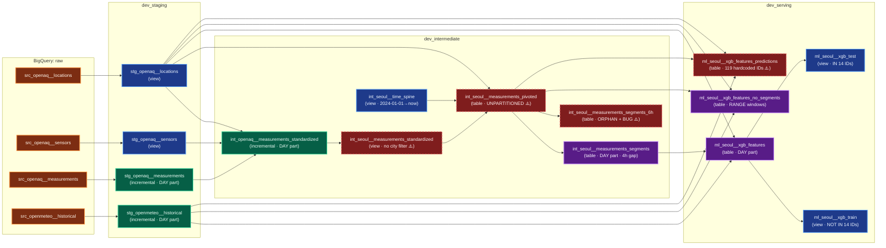

# Architectural Audit: `openaq-anomaly-prediction`


-dc2626?style=for-the-badge)
-ea580c?style=for-the-badge)


**Audit Date:** 2026-11-26  
**Scope:** End-to-end ELT stack (Python Ingestion, OpenAQ v3 & Open-Meteo Archive APIs, GCS, BigQuery, dbt, Testing, and Downstream Consumers)  
**Severity Legend:** 🔴 `CRITICAL` · 🟠 `HIGH` · 🟡 `MEDIUM` · 🟢 `HEALTHY`

---

## 1. Executive Summary & Quick-Start Revival Guide

### Pipeline Overview
`openaq-anomaly-prediction` is a batch ELT and ML feature pipeline designed to ingest hourly air quality measurements (6 pollutants: `PM2.5`, `PM10`, `NO2`, `O3`, `SO2`, `CO`) from the **OpenAQ v3 API** and hourly historical meteorology (29 variables) from the **Open-Meteo Archive API**, land them in **Google Cloud Storage (GCS)** as Snappy-compressed Parquet files, upsert them into **BigQuery (`raw` dataset)** via staging-table `MERGE` jobs, and transform them through a 15-model **dbt** project (`dev_staging` → `dev_intermediate` → `dev_serving`) to produce hourly ML feature tables for XGBoost/MLForecast anomaly detection and a Streamlit dashboard.

### Current Health Snapshot
The last recorded ingestion run in `logs/` completed on **2026-01-08** (`seoul_daily_2025-12-25_2026-01-08_1767888301.json`, 600 sensors, 0 errors, 12m 25s). Because the repository has been dormant for **~10.5 months**, simply running the rolling 14-day scripts today will leave a large historical hole (Jan 2026 – Nov 2026) and trigger subtle incremental-window traps in dbt.

> [!CAUTION]
> **Immediate Revival Blocker — 15-Day Incremental Blindspot:**  
> `stg_openaq__measurements`, `stg_openmeteo__historical`, and `int_openaq__measurements_standardized` filter incremental updates using `current_timestamp() - interval 15 day` (and `10 day` on destination). If you backfill data older than 15 days (e.g., Jan–Oct 2026), **incremental `dbt run` will silently ignore those partitions**. You must run `dbt run --full-refresh` on those models after any backfill > 15 days.

---

### Immediate Blockers & Gotchas

| Severity | Blocker / Gotcha | Location | Impact Today |
| :--- | :--- | :--- | :--- |
| 🔴 `CRITICAL` | **10.5-Month Data Gap + Incremental Window Blindspot** | `dbt_transformation/models/staging/_openaq/stg_openaq__measurements.sql:36-46`, `stg_openmeteo__historical.sql:36-46`, `int_openaq__measurements_standardized.sql:34-41` | Running daily scripts alone leaves Jan–Nov 2026 missing; backfilling without `--full-refresh` silently drops backfilled partitions from staging/intermediate. |
| 🔴 `CRITICAL` | **Hardcoded Service Account Key Override at Import Time** | `src/openaq_anomaly_prediction/config/config.py:14-17` | Unconditionally overwrites `GOOGLE_APPLICATION_CREDENTIALS` with `secrets/openaq-anomaly-prediction-cf3c3c643a9f.json` whenever `config` is imported, ignoring ADC or custom env paths. |
| 🔴 `CRITICAL` | **Open-Meteo Archive 2–5 Day Lag & Zero-Retry 429 Crash** | `scripts/openmeteo_download_range.py:780`, `src/openaq_anomaly_prediction/load/openmeteo.py:118-123` | Queries `archive-api.open-meteo.com` up to `today` (ERA5 archive lags 2–5 days, producing trailing `NULL`s). Any HTTP `429` immediately raises and aborts the run mid-loop. |
| 🟠 `HIGH` | **Env Var Name Mismatch (`GOOGLE_PROJECT_NAME` vs `GOOGLE_PROJECT_ID`)** | `examples/.env_example:5` vs `base_table.py:12`, `profiles.yml:8`, `_src_sources.yml:7` | `.env_example` documents `GOOGLE_PROJECT_NAME`, but Python and dbt require `GOOGLE_PROJECT_ID`. If unset, `Configuration.getenv()` silently returns `"default"`. |
| 🟠 `HIGH` | **Mandatory CUDA Dependency (`cudf-cu13`)** | `pyproject.toml:36` | `cudf-cu13 (>=25.12.0,<26.0.0)` is in core dependencies; `poetry install` fails on non-NVIDIA / macOS / standard CI Linux machines. |
| 🟠 `HIGH` | **Broken `main.py` & Broken GitHub Actions CI** | `main.py:4`, `.github/workflows/ci.yaml:11,38,46` | `main.py` imports non-existent `test` from `load.openaq`. CI pins Python `3.11` (conflicts with `>=3.12,<3.13`) and calls commented-out Makefile targets. |
| 🟡 `MEDIUM` | **Hardcoded Years / Skipped Trimesters in Backfill Scripts** | `scripts/openaq_download.py:86`, `scripts/openmeteo_download.py:748,756` | `openaq_download.py` is hardcoded to `years = [2025]`; `openmeteo_download.py` is hardcoded to `years = [2024]` and skips T1 & T3 (`i in [0, 2]`). |
| 🟡 `MEDIUM` | **Streamlit App Disconnected from Live BigQuery** | `src/openaq_anomaly_prediction/core/seoul_dashboard.py:133-146` | Dashboard reads static local Parquets in `data/export/` (`all_best_predictions_v1.parquet`, `anomalies_with_coordinates.parquet`), not live BigQuery tables. |

---

### Revival Checklist (Get Fresh Seoul Data Flowing Today — Zero Refactoring)

> [!IMPORTANT]
> **Prerequisites Check:** Confirm these local files exist before running any commands (both were present during this audit):
> - `secrets/.env` containing: `GOOGLE_PROJECT_ID`, `GOOGLE_APPLICATION_CREDENTIALS`, `OPENAQ_API_KEY`, `DBT_PROFILES_DIR`, `DBT_PROJECT_DIR`, `DBT_DEFAULT_DATASET`
> - `secrets/openaq-anomaly-prediction-cf3c3c643a9f.json` (GCP Service Account JSON key with GCS + BigQuery permissions in region `EU`)

1. **Activate Python environment & load environment variables**
   ```bash
   # Load secrets/.env into current shell (or use `direnv allow`)
   set -a && source secrets/.env && set +a

   # Verify Poetry / Python 3.12 environment
   poetry env info
   ```

2. **Verify BigQuery & dbt connectivity (non-destructive)**
   ```bash
   cd dbt_transformation
   poetry run dbt deps
   poetry run dbt debug
   cd ..
   ```

3. **Ingest the last 14 days of OpenAQ data for Seoul (Locations + Sensors + Hourly Measurements)**
   ```bash
   # Fetches Seoul large bbox -> upserts raw.src_openaq__locations & sensors
   # -> streams sensor Parquets to gs://<project>-staging/openaq/measurements/
   # -> MERGEs into raw.src_openaq__measurements -> clears GCS prefix
   poetry run python scripts/openaq_download_range.py
   ```
   > [!TIP]
   > Expect ~12–15 minutes for ~600 Seoul sensors under OpenAQ's 60 req/min rate limit. Logs are written to `logs/seoul_daily_<from>_<to>_<ts>.json`.

4. **Ingest the last 14 days of Open-Meteo historical weather for Seoul's 119 stations**
   ```bash
   # Fetches 119 hardcoded PERFECT_LOCATIONS -> streams to gs://<project>-staging/openmeteo/historical/
   # -> MERGEs into raw.src_openmeteo__historical -> clears GCS prefix
   # Note: OpenMeteoClient.SAVE_TO_DISK is True, so local Parquets are also written under data/parquet/
   poetry run python scripts/openmeteo_download_range.py
   ```

5. **Run dbt transformations (and verify tests)**
   ```bash
   cd dbt_transformation

   # Option A: Standard run (if you only ran the 14-day rolling scripts above)
   poetry run dbt run

   # Option B: REQUIRED if you also backfilled Jan–Nov 2026 (>15 days ago)
   # poetry run dbt run --full-refresh

   # Run existing source & staging schema tests
   poetry run dbt test

   # Check source freshness (warn >24h, error >72h on ingested_at)
   poetry run dbt source freshness
   cd ..
   ```

6. **(Optional) Launch the Streamlit Dashboard (uses local exports, not live BQ)**
   ```bash
   poetry run streamlit run services/streamlit/app.py
   ```

---

## 2. End-to-End Architecture & Data Flow

### System Data Flow Diagram

```mermaid
flowchart LR
    %% Color Palette
    classDef api fill:#0f172a,stroke:#38bdf8,stroke-width:2px,color:#f8fafc
    classDef py fill:#1e3a8a,stroke:#60a5fa,stroke-width:2px,color:#eff6ff
    classDef gcs fill:#065f46,stroke:#34d399,stroke-width:2px,color:#ecfdf5
    classDef bqRaw fill:#7c2d12,stroke:#fb923c,stroke-width:2px,color:#fff7ed
    classDef dbtStg fill:#312e81,stroke:#818cf8,stroke-width:2px,color:#eef2ff
    classDef dbtInt fill:#4c1d95,stroke:#a78bfa,stroke-width:2px,color:#f5f3ff
    classDef dbtSrv fill:#701a75,stroke:#e879f9,stroke-width:2px,color:#fdf4ff
    classDef app fill:#1f2937,stroke:#9ca3af,stroke-width:2px,color:#f9fafb
    classDef risk fill:#7f1d1d,stroke:#f87171,stroke-width:2px,stroke-dasharray: 5 5,color:#fef2f2

    subgraph EXT["External APIs (Free Tier)"]
        OAQ_API["OpenAQ v3 API<br/>/locations & /sensors/{id}/measurements/hourly<br/>(60 req/min)"]:::api
        OM_API["Open-Meteo Archive API<br/>/v1/archive (29 hourly vars)<br/>(600/m · 5k/h · 10k/d)"]:::api
    end

    subgraph ING["Python Ingestion Layer (Manual CLI Scripts)"]
        OAQ_SCR["scripts/openaq_download[_range].py<br/>AreaDownloader + OpenAQClient"]:::py
        OM_SCR["scripts/openmeteo_download[_range].py<br/>OpenMeteoClient (119 hardcoded stations)"]:::py
    end

    subgraph STG_STORE["Cloud Staging & Local Disk"]
        GCS_STG["GCS: gs://&lt;proj&gt;-staging/<br/>openaq/measurements/*.parquet<br/>openmeteo/historical/*.parquet<br/>(1-day lifecycle)"]:::gcs
        DISK["Local Disk<br/>data/parquet/ & logs/*.json"]:::app
    end

    subgraph BQ_RAW["BigQuery: raw Dataset (EU)"]
        RAW_LOC["raw.src_openaq__locations<br/>(Unpartitioned · Cluster: id)"]:::bqRaw
        RAW_SEN["raw.src_openaq__sensors<br/>(Unpartitioned · Cluster: id, loc)"]:::bqRaw
        RAW_MEA["raw.src_openaq__measurements<br/>(DAY part · Unpruned MERGE ⚠️)"]:::risk
        RAW_OM["raw.src_openmeteo__historical<br/>(DAY part · Unpruned MERGE ⚠️)"]:::risk
    end

    subgraph DBT["dbt Transformations (BigQuery EU)"]
        STG["dev_staging (4 models)<br/>2 Views + 2 Incremental Tables<br/>(15d lookback window ⚠️)"]:::dbtStg
        INT["dev_intermediate (6 models)<br/>1 Incremental + 2 Views + 3 Full Tables"]:::dbtInt
        SRV["dev_serving (5 models)<br/>3 Full ML Feature Tables + 2 Split Views"]:::dbtSrv
    end

    subgraph CONSUMERS["ML & Visualization"]
        ML["XGBoost / MLForecast<br/>core/xgboost.py & notebooks/"]:::app
        EXP["Local Static Exports<br/>data/export/*.parquet"]:::app
        UI["Streamlit App<br/>services/streamlit/app.py"]:::app
    end

    OAQ_API -->|"X-API-Key"| OAQ_SCR
    OM_API -->|"Unauthenticated"| OM_SCR

    OAQ_SCR -->|"Direct DF MERGE"| RAW_LOC
    OAQ_SCR -->|"Direct DF MERGE"| RAW_SEN
    OAQ_SCR -->|"Stream Parquet"| GCS_STG
    OAQ_SCR -->|"JSON run logs"| DISK

    OM_SCR -->|"Stream Parquet"| GCS_STG
    OM_SCR -->|"SAVE_TO_DISK=True"| DISK

    GCS_STG -->|"Load *_staged -> MERGE -> Delete"| RAW_MEA
    GCS_STG -->|"Load *_staged -> MERGE -> Delete"| RAW_OM

    RAW_LOC & RAW_SEN & RAW_MEA & RAW_OM --> STG
    STG --> INT --> SRV
    SRV -.->|"Manual BQ Export"| ML
    ML --> EXP --> UI
```



---

### Repository Map

| Path | Responsibility | Key Components | Health |
| :--- | :--- | :--- | :--- |
| `scripts/openaq_download.py` | Manual historical backfill for OpenAQ (quarterly loops) | Hardcoded `CITY_ID="seoul"`, `years=[2025]` | 🟡 `MEDIUM` |
| `scripts/openaq_download_range.py` | Manual rolling 14-day daily refresh for OpenAQ | Hardcoded Seoul large bbox, `d=14` | 🟡 `MEDIUM` |
| `scripts/openmeteo_download.py` | Manual historical backfill for Open-Meteo weather | 119 hardcoded `PERFECT_LOCATIONS`, `years=[2024]`, skips T1/T3 | 🟠 `HIGH` |
| `scripts/openmeteo_download_range.py` | Manual rolling 14-day daily refresh for Open-Meteo | Duplicate 119 `PERFECT_LOCATIONS`, `d=14`, overwrites rate estimate | 🟠 `HIGH` |
| `src/.../config/config.py` | Project paths, `.env` loader, excluded sensor list | **Overwrites `GOOGLE_APPLICATION_CREDENTIALS` on import** | 🔴 `CRITICAL` |
| `src/.../load/openaq.py` | OpenAQ v3 HTTP client, rate limiter, pagination, retry loop | `OpenAQClient`, `AreaDownloader` (1,119 LOC) | 🟠 `HIGH` |
| `src/.../load/openmeteo.py` | Open-Meteo HTTP client & DataFrame builder | `OpenMeteoClient` (no retry on 429, no request timeout) | 🟠 `HIGH` |
| `src/.../load/gcp.py` | GCS streaming + BigQuery DDL, query & `MERGE` upsert wrappers | `CloudStorageClient`, `BigQueryClient` (instantiated at import time!) | 🔴 `CRITICAL` |
| `src/.../load/schemas/*.py` | BigQuery table definitions, sanitization, and load orchestration | `BaseTable` + 4 table classes (`locations`, `sensors`, `measurements`, `historical`) | 🟡 `MEDIUM` |
| `src/.../utils/helpers.py` & `logger.py` | Date period generators, Parquet/CSV concat, JSON log serializer | `get_trimestrial_periods`, `concat_pq_to_pq`, `ProgressLogger` | 🟢 `HEALTHY` |
| `dbt_transformation/` | dbt-bigquery project (`dev_staging`, `dev_intermediate`, `dev_serving`) | 15 SQL models, 1 package (`dbt_utils 1.3.3`), minimal tests | 🟠 `HIGH` |
| `src/.../core/*.py` | ML modeling (XGBoost/MLForecast), Plotly maps, dashboard backend | `CustomXGBoostModel`, `SeoulDashboard`, `SeoulMap`, `BaseMap` | 🟡 `MEDIUM` |
| `services/streamlit/app.py` | Interactive French-language Seoul air-quality & anomaly dashboard | Reads local `data/export/*.parquet` via DuckDB | 🟡 `MEDIUM` |
| `services/api/Dockerfile` | Placeholder API container | **Empty file (0 bytes)** | 🟡 `MEDIUM` |
| `tests/` | Test suite directory | Only `assert True` placeholders (`0%` real coverage) | 🔴 `CRITICAL` |
| `.github/workflows/ci.yaml` | GitHub Actions CI pipeline | Broken (Python 3.11 mismatch, missing Makefile targets) | 🔴 `CRITICAL` |

---

## 3. Deep Dive: Ingestion Layer (OpenAQ & Open-Meteo)

### Connector Capabilities & Free-Tier Rate-Limit Audit

| Dimension | OpenAQ (`load/openaq.py`) | Open-Meteo (`load/openmeteo.py`) | Audit Risk |
| :--- | :--- | :--- | :--- |
| **Endpoint(s)** | `GET /v3/locations`<br/>`GET /v3/sensors/{id}/measurements/hourly` | `GET https://archive-api.open-meteo.com/v1/archive` | 🟢 `HEALTHY` (v3 & v1 active) |
| **Authentication** | `X-API-Key` header via `config.getenv("OPENAQ_API_KEY")` (silently defaults to `"default"` if unset) | None (free non-commercial tier) | 🟡 `MEDIUM` |
| **HTTP Client & Timeouts** | Raw `requests.get()` (**no `timeout=`**; unused `openaq` SDK in `pyproject.toml`) | Raw `requests.get()` (**no `timeout=`**) | 🔴 `CRITICAL` (can hang indefinitely) |
| **Pagination** | `load_bbox()`: **Hardcoded `page=1, limit=1000`** (no loop).<br/>`fetch_sensor_measurements()`: `while True` loop until `len(all_results) >= found_value` | Single call per `(location_id, date_range)`. Does **not** use Open-Meteo's multi-coordinate batching (`latitude=lat1,lat2,...`). | 🟠 `HIGH` (truncation / infinite loop risk / 119x excess calls) |
| **Rate-Limit Strategy** | Reads `X-Ratelimit-Remaining` & `X-Ratelimit-Reset`; sleeps `reset + 1s` when `remaining < 5`. On `429`, sleeps `60s` then re-raises. | Static counter (`ESTIMATED_CALLS_PER_REQUEST`: `20` for trimester, `3` for 14d); sleeps `70s` after `500` estimated calls. Does **not** track hourly (5,000) or daily (10,000) caps. | 🟠 `HIGH` |
| **Retry Logic** | Recursive `download_data_with_retries(max_retries=5)` per failed sensor list. No exponential backoff or jitter; retries non-retryable `4xx` errors too. | **Zero retries.** On HTTP `429` or `5xx`, immediately re-raises and crashes the entire script mid-loop. | 🔴 `CRITICAL` |
| **Storage Target** | `SAVE_TO_GCS = True`, `SAVE_TO_DISK = False` (class attributes on `AreaDownloader`) | `SAVE_TO_GCS = True`, `SAVE_TO_DISK = True` (class attributes on `OpenMeteoClient`) | 🟡 `MEDIUM` |

> [!WARNING]
> **Hidden Bugs Discovered in Ingestion & Sanitization:**
> 1. **Substring `"id"` Corruption (`base_table.py:41`):** `sanitize_dataframe()` casts every column where `"id" in col` to `str`. This inadvertently matches `relative_humidity_2m` (`hum-id-ity`) and `cloud_cover_mid` (`m-id`). They are only accidentally rescued on line 75 because they are `INT64` in the BigQuery schema; any future `STRING`/`FLOAT64` column containing `"id"` (e.g., `cloud_mid_pct`, `valid_flag`) will be corrupted.
> 2. **Infinite Pagination Loop Hazard (`openaq.py:493-538`):** If OpenAQ returns `meta.found > 0` (or a string like `">1000"`) and a subsequent page returns `0` results, `len(all_results) >= found_value` never becomes `True` — causing an infinite API request loop.
> 3. **Overwritten Rate-Limit Constant (`openmeteo_download_range.py:726-729`):** `ESTIMATED_CALLS_PER_REQUEST = 20` is immediately overwritten on line 729 by `ESTIMATED_CALLS_PER_REQUEST = 3`.
> 4. **Import-Time GCP Instantiation (`gcp.py:600-601`):** `bq = BigQueryClient()` and `gcs = CloudStorageClient()` execute at module import time. Any import in a credential-less environment (e.g., CI unit tests) crashes immediately.

---

### Seoul Hardcoding Inventory (Multi-City Gap Analysis)

| Layer | File(s) & Lines | What is Hardcoded to Seoul |
| :--- | :--- | :--- |
| **OpenAQ Ingestion** | `scripts/openaq_download.py:44-46`<br/>`scripts/openaq_download_range.py:45-47` | `CITY_ID = "seoul"`, `CITY_NAME = "Seoul"`, `CITY_BBOX = 126.678543, 37.376705, 127.282104, 37.754973` |
| **Open-Meteo Ingestion** | `scripts/openmeteo_download.py:67-673`<br/>`scripts/openmeteo_download_range.py:68-674`<br/>`src/.../load/openmeteo.py:258-317` | **119 hardcoded Seoul station dicts** (`PERFECT_LOCATIONS` with lat/lon) + `CITY_LOCATIONS_IDS` duplicated verbatim across both scripts (over 600 lines each!), plus 58 stations in `openmeteo.py:__main__`. |
| **BigQuery Raw Tables** | `src/.../load/schemas/openaq_locations.py` | **No `city_id` / `area_id` column** in `raw.src_openaq__locations` or `measurements`. Multi-city rows cannot be reliably partitioned or filtered by city downstream without spatial joins! |
| **dbt Intermediate** | `models/intermediate/seoul/*.sql` (6 models) | Directory & model names prefixed `int_seoul__*`; hardcoded start date `'2024-04-30 15:00:00'`; hardcoded 6 `parameter_id`s; **zero geographic filter** (will silently absorb any new city's stations!). |
| **dbt Serving** | `models/serving/seoul/*.sql` (5 models) | Hardcoded South Korean seasons (`yellow_dust_season`, `moonsoon_season`, school breaks), 119 Seoul station IDs in `ml_seoul__xgb_features_predictions.sql:27-147`, and 14 Seoul test station IDs in `ml_seoul__xgb_train/test.sql`. |
| **ML & Dashboard** | `core/xgboost.py:807`, `core/seoul_dashboard.py`, `core/seoul_map.py`, `services/streamlit/app.py` | Hardcoded BQ table `openaq-anomaly-prediction.dev_serving.ml_seoul__xgb_*`, Korean flag color palettes, South Korea GeoJSON URLs, French/Seoul UI strings, hardcoded `starting_date = "2025-12-01"`. |

#### What Is Required to Make Ingestion Multi-City & Config-Driven
1. **City Registry (`config/cities.yaml` or BigQuery `raw.dim_cities`):** Define each city declaratively (`city_id`, `name`, `country_code`, `bbox`, `timezone`, `active_from`, `target_parameters`).
2. **Tag `city_id` / `area_id` at Ingestion:** Add `area_id` (or `city_id`) to `raw.src_openaq__locations` (or a `raw.bridge_area_locations` mapping table) so dbt models can filter cleanly by city without bounding-box math.
3. **Dynamic Weather Target Resolution:** Replace the 600-line `PERFECT_LOCATIONS` constant in `openmeteo_download*.py` with a live query against `dev_staging.stg_openaq__locations` (filtered by `city_id` and active status), and leverage Open-Meteo's batch coordinate API (up to ~50–100 coordinates per HTTP request, cutting API calls by ~50x).
4. **CLI Interface:** Replace script-level constants with `typer` or `argparse` (`--city seoul --mode incremental|backfill --start-date ... --end-date ...`).

---

### Fragility Points in Ingestion

- **🔴 Non-Isolated GCS Staging Bucket (Race Condition & Partial-Run Corruption):**  
  `OpenAQMeasurementsTable.save_from_staging_bucket()` loads `gs://<project>-staging/openaq/measurements/*.parquet` and then deletes *everything* under that prefix (`gcs.clear_staging_bucket`). If a run crashes halfway through (e.g., Open-Meteo HTTP 429) or two cities run concurrently, leftover Parquets either get merged into the wrong run or deleted prematurely. **Fix:** Scope GCS paths by `run_id` (`openaq/measurements/{run_id}/*.parquet`).
- **🔴 No Watermarks / State Tracking:**  
  Daily scripts blindly re-fetch a fixed 14-day window (`d = 14`). If a pipeline outage lasts >14 days, data is permanently missed until someone manually edits and runs a backfill script. **Fix:** Query `MAX(period_datetimeTo_utc)` per `sensor_id` (with a configurable 24–48h overlap buffer for late-arriving data) from BigQuery before fetching.
- **🟠 Unpruned BigQuery `MERGE`:**  
  `BigQueryClient.generate_merge_query()` (`gcp.py:416-432`) joins `target` and `staged` on primary keys without restricting `target`'s partition column (`period_datetimeTo_utc` / `datetimeto_utc`). Every daily upsert triggers a **full-table scan of the raw partitioned table**.
- **🟠 Silent Query Failures:**  
  `BigQueryClient.query()` (`gcp.py:175-187`) catches `GoogleCloudError`, logs it, and returns `None` instead of raising — risking cryptic `AttributeError` / `TypeError` failures downstream.

---

## 4. Deep Dive: Transformation & Storage (BigQuery & dbt)

### dbt Project Overview
- **Engine:** `dbt-core >= 1.11.2`, `dbt-bigquery >= 1.11.0`, `dbt_utils 1.3.3`
- **Profile:** `oap_profile` (`dbt_transformation/profiles.yml`), location `EU`, `threads: 4`, `dev` uses `service-account` keyfile, `prod` uses `oauth`.
- **Schemas:** Default dataset `dev` (`DBT_DEFAULT_DATASET`) + custom schema suffixes → `dev_staging`, `dev_intermediate`, `dev_serving`.

### dbt Model Lineage Graph



---

### Model Inventory & BigQuery Storage Strategy

| Layer | Model | Materialization | Partitioning | Clustering | Key Issues |
| :--- | :--- | :--- | :--- | :--- | :--- |
| **Staging** | `stg_openaq__locations` | `view` | — | — | Healthy lightweight rename view |
| **Staging** | `stg_openaq__sensors` | `view` | — | — | Healthy lightweight rename view |
| **Staging** | `stg_openaq__measurements` | `incremental` (`insert_overwrite`) | `DAY(datetimeto_utc)` | `sensor_id, datetimeto_utc` | Function-wrapped partition filter (`timestamp_trunc(...) IN (...)`) + 15d lookback blindspot |
| **Staging** | `stg_openmeteo__historical` | `incremental` (`insert_overwrite`) | `DAY(datetimeto_utc)` | `location_id` | Same function-wrapped partition filter + 15d lookback blindspot |
| **Intermediate** | `int_openaq__measurements_standardized` | `incremental` (`insert_overwrite`) | `DAY(datetimeto_utc)` | `location_id, sensor_name, datetimeto_utc` | Asymmetric lookback (15d source vs 10d target) + function-wrapped partition filter |
| **Intermediate** | `int_seoul__measurements_standardized` | `view` | — | — | Hardcoded date `>= 2024-04-30 15:00:00`; **no city filter** |
| **Intermediate** | `int_seoul__time_spine` | `view` | — | — | Generates hourly timestamps from `2024-01-01` to `current_timestamp()` |
| **Intermediate** | `int_seoul__measurements_pivoted` | `table` | **None** 🔴 | `location_id` | Full rebuild every run; cross-joins **all** locations in `stg_openaq__locations` (no city filter) |
| **Intermediate** | `int_seoul__measurements_segments` | `table` | `DAY(datetimeto_utc)` | `location_id, segment_id, segment_tier` | Full rebuild every run; complex multi-pass window functions |
| **Intermediate** | `int_seoul__measurements_segments_6h` | `table` | `DAY(datetimeto_utc)` | `location_id, segment_id, segment_tier` | **Orphan model** (no consumers) + logic bug (shatters at `>= 6h` on L73, filters `<= 4h` on L94) |
| **Serving** | `ml_seoul__xgb_features` | `table` | `DAY(datetimeto_utc)` | `location_id, segment_tier` | Full rebuild every run; Korean-specific calendar/season features |
| **Serving** | `ml_seoul__xgb_features_no_segments` | `table` | `DAY(datetimeto_utc)` | `location_id` | Full rebuild every run; heavy `RANGE` windows over full spine; ~500 lines duplicated SQL |
| **Serving** | `ml_seoul__xgb_features_predictions` | `table` | `DAY(datetimeto_utc)` | `location_id` | Full rebuild every run; hardcoded `IN (119 IDs)`; ~600 lines duplicated SQL; stale `-- depends_on` comment |
| **Serving** | `ml_seoul__xgb_train` | `view` | — | — | Hardcoded `NOT IN (14 Seoul location IDs)` |
| **Serving** | `ml_seoul__xgb_test` | `view` | — | — | Hardcoded `IN (14 Seoul location IDs)` |

---

### BigQuery Cost & Maintainability Risks

> [!WARNING]
> **No Cost Guardrail Active:** `maximum_bytes_billed: 1000000000` (1 GB) is commented out in `dbt_transformation/profiles.yml:16,28`. A single accidental full-table scan or multi-city cross-join will bill uncapped.

1. **🔴 Unpruned `MERGE` in Python Loader (`gcp.py:416-432`):** Every daily run scans the entire `raw.src_openaq__measurements` and `raw.src_openmeteo__historical` tables instead of pruning `target` to the min/max timestamps present in `_staged`.
2. **🔴 Full-Table Rebuild Cascade on Every `dbt run`:** 6 heavy intermediate/serving models (`int_seoul__measurements_pivoted`, 2 segment tables, and 3 `ml_seoul__xgb_features*` tables) are materialized as full `table`s. As multi-year and multi-city data grows, every `dbt run` recomputes 100% of history 3x over across duplicated feature SQL.
3. **🟠 Partition Pruning Defeated by `timestamp_trunc()` Subquery (`stg_openaq__measurements.sql:29`):** Wrapping the partition key `period_datetimeTo_utc` in `timestamp_trunc(...) IN (SELECT ...)` prevents BigQuery static partition pruning on the outer scan. Using `dbt` dynamic `partitions_to_replace` or a direct `period_datetimeTo_utc >= timestamp_sub(...)` predicate on the outer `WHERE` clause guarantees partition pruning.
4. **🟠 Massive SQL Duplication (DRY Violation):** `ml_seoul__xgb_features.sql` (536 LOC), `ml_seoul__xgb_features_no_segments.sql` (595 LOC), and `ml_seoul__xgb_features_predictions.sql` (693 LOC) copy-paste the same time, weather, and pollutant feature engineering logic — and have already drifted (e.g., `no_segments` uses `sin/cos` wind direction while `features` and `predictions` use `u/v` wind vectors; `no_segments` computes `lag168` features that are commented out in `features`!).

---

## 5. Testing & Reliability Gap Analysis

### Current Coverage Audit

| Layer | What Exists Today | Actual Coverage | Severity |
| :--- | :--- | :--- | :--- |
| **Python Unit Tests** | `tests/unit_tests/test_placeholder.py` (`assert True`)<br/>`tests/unit_tests/test_data_processing.py` (`assert True`) | **0%** (`pytest` is not even in `pyproject.toml`) | 🔴 `CRITICAL` |
| **Python Integration Tests** | `tests/integration_tests/.gitkeep` (empty) | **0%** | 🔴 `CRITICAL` |
| **dbt Source Tests** | `unique`/`not_null` on `locations.id` & `sensors.id`; `relationships` on `sensors.location_id`; `not_null` on `measurements.sensor_id` & `historical.location_id`; `freshness` (24h/72h) | Partial (Raw metadata only; no composite PK checks) | 🟡 `MEDIUM` |
| **dbt Staging Tests** | `unique`/`not_null` on `stg_openaq__locations.id` & `stg_openaq__sensors.id` | **0%** on fact tables (`measurements`, `historical`) — commented out for cost | 🟠 `HIGH` |
| **dbt Intermediate & Serving Tests** | **None** (`_ml_seoul__models.yml` is 100% commented out) | **0%** on all 11 intermediate & serving models | 🔴 `CRITICAL` |
| **CI/CD Automation** | `.github/workflows/ci.yaml` (runs `make setup`, `make install_precommit`, `make run_tests` on Python 3.11) | **Broken** (Python version conflict + missing Makefile targets) | 🔴 `CRITICAL` |

---

### Concrete Testing Blueprint (Pre-Automation Gate)

Before scheduling automated runs, implement the following minimal, cost-aware test pyramid:

| Layer | Tooling | Specific Test Cases to Implement | Cost / Execution Guardrail |
| :--- | :--- | :--- | :--- |
| **1. API Connectors** (`load/openaq.py`, `load/openmeteo.py`) | `pytest`, `responses` (or `respx`), `pytest-mock` | • Mock `200`, `429` (with `X-Ratelimit-Reset`), `500`, and timeout responses<br/>• Verify multi-page pagination & termination when `results=[]` (prevent infinite loops)<br/>• Verify `load_bbox()` pagination when `found > 1000`<br/>• Verify Open-Meteo retry/backoff on `429` and timezone localization | 100% offline, <2s runtime, zero API quota consumed |
| **2. Schema Sanitizers & BQ Loaders** (`load/schemas/*.py`, `load/gcp.py`) | `pytest`, `pandas.testing` | • Unit-test `BaseTable.sanitize_dataframe()` with edge cases: columns containing `"id"` (`relative_humidity_2m`, `cloud_cover_mid`), mixed tz-aware/naive datetimes, empty strings, all-NaN numeric columns<br/>• Unit-test `BigQueryClient.generate_merge_query()` output SQL to assert partition pruning predicate and immutable `ingested_at` column<br/>• Verify `gcp.py` does not connect to GCP at import time (lazy client init) | 100% offline, <1s runtime |
| **3. dbt Staging & Intermediate** (`dbt_transformation/`) | `dbt test` + `dbt_utils` + partition-scoped `where` config | • Composite uniqueness on `(sensor_id, datetimeto_utc)` in `stg_openaq__measurements` and `(location_id, datetimeto_utc)` in `stg_openmeteo__historical` scoped via `config: {where: "datetimeto_utc >= timestamp_sub(current_timestamp(), interval 7 day)"}` (FinOps-safe!)<br/>• `not_null` on `location_id`, `datetimeto_utc`, `segment_id`<br/>• `accepted_values` on `segment_tier` (`gold`, `silver`, `bronze`)<br/>• Range check: pollutant values `>= 0` and `< 10000` in `int_*__measurements_standardized` | Partition-scoped `where` keeps BigQuery test scans to a few MB |
| **4. dbt Serving / ML Contracts** | `dbt test` + `dbt_utils.expression_is_true` | • No future data leakage: verify rolling/expanding features are `NULL` on the first row of a location<br/>• Zero overlap between `ml_*__xgb_train` and `ml_*__xgb_test` `location_id`s<br/>• Non-empty weather join coverage rate (`>= 95%` non-null `om_temperature_2m` for timestamps older than 5 days) | Runs post-`dbt run` in CI/CD & scheduled jobs |
| **5. CI Gate** (`.github/workflows/ci.yaml`) | GitHub Actions, `ruff`, `pytest`, `dbt parse` | • Fix Python version to `3.12`<br/>• Run `ruff check`, `pytest tests/unit_tests`, and `dbt parse` (offline syntax/DAG validation) on every PR | Zero GCP credentials required for PR checks |

---

## 6. Prioritized Action Plan (Agent-Ready Roadmap)

### Phase 1: Stabilize & Refresh (Get Seoul Data Updating Cleanly in BigQuery)

| ID | Priority | Effort | Files Touched | Goal |
| :--- | :--- | :--- | :--- | :--- |
| **P1.1** | 🔴 `CRITICAL` | S (1h) | `src/.../config/config.py`, `examples/.env_example`, `src/.../load/schemas/base_table.py` | Stop overwriting `GOOGLE_APPLICATION_CREDENTIALS` if already set in env; align `GOOGLE_PROJECT_ID` across `.env_example` and code; fail fast if required env vars are missing instead of returning `"default"`. |
| **P1.2** | 🔴 `CRITICAL` | S (1h) | `pyproject.toml`, `main.py`, `dbt_transformation/profiles.yml` | Move `cudf-cu13` to an optional `[project.optional-dependencies] gpu` group; fix broken `main.py` import; uncomment `maximum_bytes_billed` in `profiles.yml` (e.g., 5 GB) as a FinOps safety net. |
| **P1.3** | 🔴 `CRITICAL` | M (2–4h) | `scripts/openaq_download.py`, `scripts/openmeteo_download.py` | Backfill the Jan 2026 – Nov 2026 Seoul gap for OpenAQ and Open-Meteo (respecting Open-Meteo's 5-day ERA5 lag and daily 10k call cap), then run `dbt run --full-refresh` to rebuild staging/intermediate cleanly. |
| **P1.4** | 🟠 `HIGH` | S (1h) | `dbt_transformation/models/intermediate/seoul/int_seoul__measurements_segments_6h.sql`, `int_seoul__measurements_pivoted.sql` | Remove or disable the orphaned/buggy `int_seoul__measurements_segments_6h` model; add `partition_by: DAY(datetimeto_utc)` to `int_seoul__measurements_pivoted`. |

---

### Phase 2: Harden Ingestion & Testing (Resilience, Idempotency & FinOps)

| ID | Priority | Effort | Files Touched | Goal |
| :--- | :--- | :--- | :--- | :--- |
| **P2.1** | 🔴 `CRITICAL` | M (3–4h) | `src/.../load/gcp.py`, `src/.../load/schemas/openaq_measurements.py`, `openmeteo_historical.py` | Lazy-initialize `BigQueryClient` / `CloudStorageClient` (remove import-time instantiation); add partition-pruning `AND target.<part_col> BETWEEN ...` to `generate_merge_query()`; isolate GCS staging uploads by `{run_id}` prefix; raise exceptions in `bq.query()` instead of returning `None`. |
| **P2.2** | 🔴 `CRITICAL` | M (3–4h) | `src/.../load/openaq.py`, `src/.../load/openmeteo.py`, `src/.../load/schemas/base_table.py` | Add `timeout=(10, 30)` and exponential-backoff retries (`tenacity` or `urllib3.Retry`) for both OpenAQ and Open-Meteo (including HTTP `429`/`5xx`); fix `load_bbox()` pagination & empty-page loop guard; fix `sanitize_dataframe()` `"id"` substring bug (`col == "id" or col.endswith("_id")`). |
| **P2.3** | 🟠 `HIGH` | M (3h) | `src/.../load/openmeteo.py`, `scripts/openmeteo_download*.py` | Batch Open-Meteo coordinate requests (comma-separated lat/lon lists) to cut API calls by ~50x and stay safely inside free-tier limits; cap `end_date` at `today - 5 days` for `/v1/archive` (or use Forecast API for recent 5 days). |
| **P2.4** | 🟠 `HIGH` | M (4h) | `dbt_transformation/models/staging/_openaq/stg_openaq__measurements.sql`, `stg_openmeteo__historical.sql`, `int_openaq__measurements_standardized.sql` | Rewrite incremental `WHERE` clauses to enable true static partition pruning on source tables and align lookback windows across staging and intermediate. |
| **P2.5** | 🟠 `HIGH` | M (4–6h) | `pyproject.toml`, `tests/unit_tests/*.py`, `dbt_transformation/models/**/*.yml`, `.github/workflows/ci.yaml` | Add `pytest`, `responses`, and `pytest-mock` to dev dependencies; implement the Section 5 Testing Blueprint (unit tests + partition-scoped dbt tests); repair `.github/workflows/ci.yaml` for Python 3.12. |

---

### Phase 3: Multi-City Generalization (Decouple Seoul)

| ID | Priority | Effort | Files Touched | Goal |
| :--- | :--- | :--- | :--- | :--- |
| **P3.1** | 🟠 `HIGH` | M (3–4h) | `config/cities.yaml` (new), `src/.../load/schemas/openaq_locations.py`, `src/.../load/openaq.py` | Introduce a declarative `cities.yaml` registry (`city_id`, `bbox`, `country_code`, `timezone`, `parameters`); persist `city_id` / `area_id` on `raw.src_openaq__locations` (or a mapping table) during `load_bbox()`. |
| **P3.2** | 🟠 `HIGH` | M (3–4h) | `scripts/openaq_download*.py`, `scripts/openmeteo_download*.py` (consolidate into `src/.../cli.py`) | Replace 4 hardcoded scripts with a single watermark-aware CLI (`oap ingest openaq --city seoul`, `oap ingest openmeteo --city seoul`) that dynamically queries active station coordinates from BigQuery instead of `PERFECT_LOCATIONS`. |
| **P3.3** | 🟡 `MEDIUM` | L (6–8h) | `dbt_transformation/models/intermediate/*`, `models/serving/*`, `dbt_transformation/macros/` (new) | Refactor `int_seoul__*` and `ml_seoul__*` into city-agnostic models keyed by `city_id` (filtering explicitly by `city_id`!); extract shared weather/time/pollutant feature SQL into reusable dbt macros to eliminate the 3x duplication across `ml_*__xgb_features*`; replace hardcoded Korean holidays/seasons with a country-keyed seed table. |
| **P3.4** | 🟡 `MEDIUM` | M (4h) | `src/.../core/seoul_dashboard.py`, `seoul_map.py`, `services/streamlit/app.py` | Generalize dashboard & map classes to accept `city_id` from the city registry and load GeoJSON/thresholds dynamically. |

---

### Phase 4: Automation (Production-Grade Orchestration)

| ID | Priority | Effort | Files Touched | Goal |
| :--- | :--- | :--- | :--- | :--- |
| **P4.1** | 🟡 `MEDIUM` | M (3–4h) | `Dockerfile` (new), `services/api/Dockerfile`, `dbt_transformation/profiles.yml` | Containerize the ingestion + dbt ELT runner (slim Python 3.12 image without `cudf`/Jupyter); migrate GCP auth from static JSON keyfile to Application Default Credentials / Workload Identity Federation. |
| **P4.2** | 🟡 `MEDIUM` | M (4–6h) | `.github/workflows/elt_daily.yaml` (new) *or* Cloud Run Jobs + Cloud Scheduler / Prefect | Schedule daily watermark-based OpenAQ + Open-Meteo ingestion followed by `dbt build` (run + test) and `dbt source freshness`, with failure notifications (Slack/email/GitHub Issues). |
| **P4.3** | 🟡 `MEDIUM` | M (4h) | `src/.../core/seoul_dashboard.py`, `services/streamlit/app.py` | Point the Streamlit app to live BigQuery serving tables (or scheduled GCS Parquet snapshots) with `st.cache_data(ttl=3600)` so refreshed data flows all the way to the UI automatically. |
