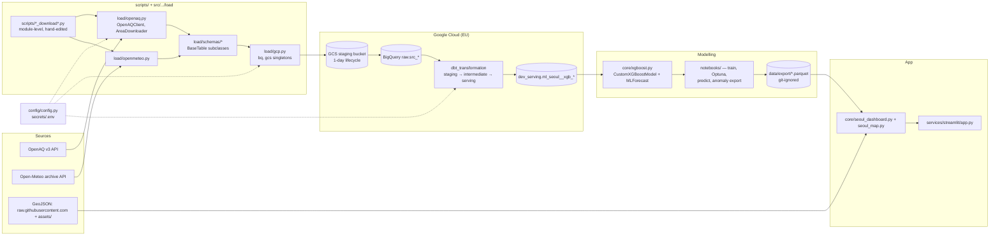

# Codebase Audit — openaq-anomaly-prediction

> Audited 2026-11-26 on branch `chore/codebase-audit` (commit `c749ed1`), read-only: **no existing file was changed** (the only file created is this one). Severity scale: Critical / High / Medium / Low / Info. Finding IDs are stable (`SEC-`, `BUG-`, `ARCH-`, `QUAL-`, `TEST-`, `CI-`, `DEP-`, `PERF-`, `DX-`, `DBT-`, `ML-`, `NB-`).
> Not-run items (and why) are listed in section 7. Assumptions I made are marked **[assumption]**.

## 1. Executive summary

- **What it is:** a single-author data/ML project that ingests hourly air-quality data (OpenAQ v3 API) and weather (Open-Meteo) for **Seoul**, lands it in GCS → BigQuery (`raw`), transforms it with **dbt** (staging → intermediate → serving), trains per-pollutant **XGBoost/MLForecast** models, and shows forecasts + anomalies in a **Streamlit** demo (French UI). ~7.6k lines of Python, ~3.1k lines of dbt SQL, 5 notebooks, 22 commits (last feature work 2026-01-09; a timezone fix on 2026-11-25).
- **Overall health: prototype-grade.** The data-engineering foundations are good (idempotent MERGE upserts, partitioned/clustered tables, incremental dbt models, freshness checks, consistent `ruff format`), but the project is not reproducible, not tested and not CI-protected. **No secrets were found** in the tree or git history.
- **Risk 1 — The anomaly layer is not in the repo (ARCH-03, ARCH-05, High).** The parquet files the app and notebooks consume (`anomalies_top_100pct_contributors.parquet`, `anomalies_with_coordinates.parquet`, `all_best_predictions_v1.parquet`) are git-ignored and **no versioned code writes the anomaly scoring ones**; README promises auto-encoders, the repo contains only XGBoost forecasting. Losing one notebook/laptop loses the product's core.
- **Risk 2 — "Works on my machine" (ARCH-01, BUG-01, BUG-15, DEP-01, CI-01, TEST-01, High).** Importing any `load/*` module instantiates GCP clients (needs credentials); config overrides the credentials path with a file that isn't present; `device="cuda"` and `cudf-cu13` are hardcoded; 8 declared deps are unused and 8 used deps are undeclared; CI references Makefile targets/pre-commit config that don't exist (and Python 3.11 vs 3.12); the only tests are `assert True`.
- **Risk 3 — Silent data-correctness/robustness bugs in ingestion and modelling (BUG-03, BUG-11, BUG-14, ARCH-04, High).** Infinite paging loop if a page comes back short; staging-bucket cleanup deletes files from concurrent runs; `"id" in col` turns missing `provider_name` into the text `"nan"`; training query hard-codes `datetimeto_utc <= '2026-01-01'` (the model can never see newer data) plus Seoul/KR/project constants — contradicting the multi-city intent behind commit `c749ed1`.
- **No Critical issues** (nothing exploitable or data-destroying by default). 15 High, 33 Medium, 22 Low (+1 Info). Fastest wins: a `.gitignore`/tracked-file cleanup, config/env fixes, dependency pruning, one real CI job — all S/M tasks at the top of the backlog (section 4).

## 2. Architecture overview

Batch pipeline with a thin presentation layer. Ingestion is driven by four top-level **scripts** (edited by hand per city/period), the transformation is **dbt on BigQuery**, modelling happens in `core/xgboost.py` + **notebooks**, and the demo app reads **local parquet exports**, not BigQuery.



**Key facts about the wiring**
- Package `src/openaq_anomaly_prediction/`: `config/` (paths, env), `load/` (API clients, GCP wrappers, BigQuery table schemas), `core/` (model, time-series utils, dashboard, maps), `utils/` (helpers, loguru wrapper). Layers import each other freely and instantiate **module-level singletons** (`bq`, `gcs`, `client`) — see ARCH-01.
- Data flow keys: `sensor_id` + `period_datetimeTo_utc` (measurements PK), `location_id`, `segment_id` (continuous-data segments built in dbt), MLForecast `unique_id = segment_id`.
- Entry points: `scripts/openaq_download*.py`, `scripts/openmeteo_download*.py` (ingest), `dbt` CLI (transform), notebooks (train/predict), `streamlit run services/streamlit/app.py` (demo). `main.py` is broken; `services/api/Dockerfile` is empty.

---
## 3. Findings
(Part 1: config/load/GCP/scripts · Part 2: ML/core/app/dbt/notebooks · Part 3: security/testing/CI/deps/perf/DX)
---
## FINDINGS — PART 1: config, load layer (OpenAQ / Open-Meteo / GCP), scripts
*(Findings are appended per area as the audit proceeds. IDs are stable; severities: Critical / High / Medium / Low.)*

### Config & import-time side effects

**BUG-01 — High — `src/openaq_anomaly_prediction/config/config.py:12-17`**
Config unconditionally overwrites `GOOGLE_APPLICATION_CREDENTIALS` with `secrets/openaq-anomaly-prediction-cf3c3c643a9f.json` (a hardcoded service-account filename, with a `# TODO: Get rid of this abomination` comment). That file does **not** exist in `secrets/` right now (only `.env` and `.gitkeep`), and the value the user sets in `secrets/.env` is silently discarded. dbt's `profiles.yml:10` reads the same env var, so dbt and Python can disagree.
*Fix:* only set the variable if unset (`os.environ.setdefault`) or drop the override and rely on `.env`; fail fast with a clear message if the file is missing.

**ARCH-01 — High — `load/gcp.py:600-601`, `load/openaq.py:1113`, `load/openmeteo.py:~233`**
Module-level singletons (`bq = BigQueryClient()`, `gcs = CloudStorageClient()`, `client = OpenAQClient()`) create cloud clients **at import time**. Any `import openaq_anomaly_prediction.load.openaq` (or `schemas.*`, which import `gcp`) requires working GCP credentials and a project. Consequences: tests can't import these modules without mocking the environment; `main.py`, the notebooks and scripts all fail with an opaque auth error on a fresh machine; `Configuration` also calls `os.makedirs` for `data/`, `logs/` at *class-definition* time (`config.py:30-37`).
*Fix:* lazy factories (`get_bq()`, `functools.cache`) or dependency injection through constructors; move `makedirs` to an explicit `ensure_dirs()`.

**BUG-02 — Medium — `config/config.py:52-56`**
`Configuration.getenv()` returns the literal string `"default"` when a variable is missing, and re-runs `load_dotenv` on every call. `OPENAQ_API_KEY` missing → header `X-API-Key: default` → confusing 401/403; `GOOGLE_PROJECT_ID` missing → table ids like `default.raw.src_openaq__measurements` (`schemas/base_table.py:12,29`).
*Fix:* return `None`/raise for required vars; add one `Settings` object (e.g. pydantic-settings or a small dataclass) validated once at startup.

**QUAL-01 — Low — `config/config.py:58-126`**
`get_excluded_sensors()` holds ~60 hardcoded Paris sensor ids (and its only call site, `load/openaq.py:421`, is commented out; the comment itself says the approach doesn't work). Dead code.

### OpenAQ client & downloader (`load/openaq.py`, 1119 lines)

**BUG-03 — High — `load/openaq.py:440-538` (`fetch_sensor_measurements` paging loop)**
`while True:` only exits when `len(all_results) >= found_value` (line 525). If the API returns an empty page while `found` is larger than what was collected (rolling data, sensor data changing mid-download, or `found` reported as ">1000"-style), `page` increments forever — an infinite request loop that also burns the rate limit. There is no `if len(results) == 0: break` guard (line 493 only logs).
*Fix:* break when a page returns 0 rows or `page * limit >= found`; add a max-page safety cap.

**BUG-04 — Medium — `load/openaq.py:545` (`final_message = message`)**
`message` is only assigned inside `if verbose >= 5:` (lines 505-514). Calling `fetch_sensor_measurements(..., verbose<5)` with results → `UnboundLocalError`. Today the only caller passes `verbose=5` (line 641), so it is latent, but the public default (`verbose=0`) is broken.

**BUG-05 — Medium — `load/openaq.py:117`, `load/openmeteo.py:~98`**
`requests.get(...)` has no `timeout`. A stalled connection hangs the whole multi-hour download with no error. Also no `Retry`/backoff session; the 429 branch (line 162-171) sleeps 60 s **and then re-raises**, so the retry has to come from the outer recursion in `download_data_with_retries`.
*Fix:* `requests.Session` with `HTTPAdapter(Retry(...))` and `timeout=(5, 60)`.

**BUG-06 — Medium — `load/openaq.py:289-329` (`load_bbox`)**
Fetches `/v3/locations` with `limit=1000, page=1` and never paginates. For a large bbox (the "Seoul LARGE" bbox, or any other city) locations beyond 1000 are silently dropped. Also uses the module-global `client` instead of an injected one (hidden dependency; defined at line 1113, after the class).

**BUG-07 — Medium — `load/openaq.py:622`**
`max(sensors_id)` raises `ValueError` on an empty list (`download_sensors_data`). `download_period_from_area` guards the empty case (line 871) but `download_sensors_data` is public and also reachable from the retry recursion.

**BUG-08 — Medium — `load/openaq.py:896-914` & `load/openaq.py:548-554`**
When a period ends `aborted` (max retries reached with failing sensors) the code `pass`es (line 899) and still triggers `save_from_staging_bucket()` and marks `[PARTIAL]`. Partial data is upserted silently and the failed `(sensor, period)` pairs exist only in a JSON log under `logs/`; there is no mechanism to resume only the failed sensors later.

**BUG-09 — Low — `load/openaq.py:21`**
`from shapely import length` — unused, and `shapely` is **not** declared in `pyproject.toml` (only available transitively). Remove.

**QUAL-02 — Medium — `load/openaq.py:211-224`**
`print_period_logs` has a pasted traceback in a `# TODO: Fix errors` comment (`list indices must be integers or slices, not str`) — a known bug left unfixed; it's caused by `download_period_from_area` returning `[]` (line 876) for empty periods, which gets appended to `all_logs` in the scripts and later indexed as a dict.

**QUAL-03 — Medium — `load/openaq.py` overall**
1119 lines, ~40% commented-out code, 5+ levels of `verbose >= N` branches interleaved with business logic, kwargs-dict APIs (`kwargs.get("verbose", ...)`) instead of typed params, and `print()` mixed with `loguru`. `fetch_sensor_measurements` alone is ~200 lines doing HTTP paging, progress rendering, GCS upload and disk upload.
*Fix (refactor, no behaviour change):* split into `OpenAQApi` (HTTP + paging), `MeasurementSink` (GCS / disk), `ProgressReporter`; replace `verbose` ints with logger levels.

### Open-Meteo (`load/openmeteo.py`)

**BUG-10 — Medium — `load/openmeteo.py` `download_weather_data` (~L233-262)**
`cleaned_df` is only assigned inside `if SAVE_TO_GCS:` / `if SAVE_TO_DISK:`; with both flags off → `UnboundLocalError` at `return cleaned_df`. With both on (default: both `True`, line ~48), `clean_dataframe` runs twice and stamps two different `ingested_at` values.

**QUAL-04 — Low — `load/openmeteo.py:~170-190`**
Commented-out pickle cache plus a `__main__` block containing a 58-entry hardcoded Seoul id→coords dict (~L270-330). The same ids also appear as `CITY_LOCATIONS_IDS` in `scripts/openmeteo_download*.py:672`. Three copies of "which locations do we use" with no single source of truth.

### GCP / BigQuery (`load/gcp.py`)

**BUG-11 — High — `load/gcp.py:103-111` + `:521-528` + `load/schemas/openaq_measurements.py` `save_from_staging_bucket`**
`clear_staging_bucket()` deletes **every blob under the prefix** and `if blobs:` (line 110) is always truthy (it's an iterator). The upsert loads `gs://…-staging/openaq/measurements/*.parquet` (everything in the folder), merges, then deletes everything in the folder. So: (a) two concurrent runs (or a script run + notebook) clobber each other — files uploaded between the load job and the delete are lost without being merged; (b) a failure *between* load and delete leaves stale files that get re-merged next time (harmless thanks to MERGE, but unbounded growth).
*Fix:* load files by explicit list/run-id prefix (`openaq/measurements/{run_id}/…`) and delete only those; wrap load→merge→cleanup in `try/finally` so the `_staged` table is always dropped.

**BUG-12 — Medium — `load/gcp.py:175-187`**
`BigQueryClient.query()` catches `GoogleCloudError`, `print({e.message})` (prints a Python *set*), and returns `None`. Callers (dashboard/app) then crash later with `AttributeError: 'NoneType'…` far from the cause. Same file: `except Exception as e: raise e` (line 189) is a no-op that loses nothing but adds noise.
*Fix:* log + re-raise a typed exception.

**BUG-13 — Medium — `load/gcp.py:466-515` (`upsert_data`)**
If `load_*_to_bq` or the MERGE fails, the `<table>_staged` table is left behind; the next run's `WRITE_TRUNCATE` hides this, but the merge failure message is lost. No `try/finally`.

**SEC-01 — Low — `load/gcp.py:416-432`**
`generate_merge_query` interpolates table/column names with f-strings. Inputs come from internal schema objects, not user input, so this is *not exploitable today*; noted only so it isn't extended to user-supplied identifiers. (`query()` correctly supports parameterised queries.)

**QUAL-05 — Low — `load/gcp.py:240`, `:121`**
`self.client.dataset(...)` is deprecated in google-cloud-bigquery; `location="EU"` is hardcoded in four places (`gcp.py:61,121,241`, `dbt profiles.yml:11,23`).

### Schema classes (`load/schemas/*.py`)

**BUG-14 — High — `load/schemas/base_table.py:41-43`**
`id_columns = [col for col in df.columns if "id" in col]` is a **substring** test. It matches **`provider_name`** (locations schema `openaq_locations.py:51`; "prov**id**er") and **`relative_humidity_2m`** (Open-Meteo; "hum**id**ity"), plus anything else containing the letters "id". Matched columns are `astype(str)`'d, turning `NaN` into the literal string `"nan"`. For `relative_humidity_2m` the later FLOAT64 coercion (lines 61-67) repairs it (wasteful round-trip); for `provider_name` (STRING, no repair) a missing provider is stored as the text `"nan"` in BigQuery. `sanitize_dataframe` is used by all four table classes (`openaq_locations.py:110`, `openaq_sensors.py:97`, `openaq_measurements.py:128`, `openmeteo_historical.py:119`).
*Fix:* match `col == "id" or col.endswith("_id")`, or drive it from the BigQuery schema (STRING fields named `*_id`).
*(Also: `openaq_locations.py:~150` does `pd.DataFrame(cleaned_df["bounds"].tolist())` — crashes if any location has `bounds=None`.)*

**QUAL-06 — Low — `load/schemas/base_table.py:13-16`**
`self.table_id = None` assigned twice. `BaseTable` reads `cfg.getenv("GOOGLE_PROJECT_ID")` at construction (and at import time in `openaq_measurements.py:~85` for the foreign key) — see BUG-02.

### Scripts (`scripts/*.py`)

**ARCH-02 — High — `scripts/openaq_download.py`, `openaq_download_range.py`, `openmeteo_download.py`, `openmeteo_download_range.py` (113 / 122 / 988 / 918 lines)**
Four "scripts" that run everything at **module top level** (no `main()`, no `if __name__ == "__main__"`, no argparse): the city, bbox, years, location lists are edited in the source before running. `openmeteo_download*.py` are ~395 differing lines of ~900 each (copy-paste fork); the first 600+ lines are data (`PERFECT_LOCATIONS`, line 67; `CITY_LOCATIONS_IDS`, line 672). They import unused `matplotlib/seaborn/pyarrow`. They are the real ingestion entry points but are untested and can't be imported.
*Fix:* one CLI (`python -m openaq_anomaly_prediction.cli download --city seoul --from … --to …`), city definitions in a YAML/JSON (id, name, bbox, timezone derived from data), and the id lists moved to a data file or BigQuery table.

**QUAL-07 — Medium — `main.py:4,14`**
`from openaq_anomaly_prediction.load.openaq import test` — **no `test` exists in `load/openaq.py`** (only a commented `test_query` in `gcp.py:649`). `python main.py` raises `ImportError`. It is also referenced by README/CI as an entry point conceptually. Delete or replace with a real CLI.

---
## FINDINGS — PART 2: ML / core, Streamlit app, dbt, notebooks

### ML & core (`src/openaq_anomaly_prediction/core/`)

**ARCH-03 — High — product vs. code mismatch (`README.md:3`, `pyproject.toml`)**
README advertises *"daily anomaly predictions … using neural networks (auto-encoders)"*. The code is **XGBoost forecasting via MLForecast** (`core/xgboost.py`); there is no torch/keras/autoencoder anywhere. `mlflow`, `optuna` (notebook-only), `statsforecast` are declared but the model isn't tracked/registered. More importantly **the anomaly decision itself (`is_anomaly`) is computed only inside notebooks** (`notebooks/OpenAQ_XGBoost_predict.ipynb` cells around the `anomalies_df`/`final_df['is_anomaly']` code) and written to `data/export/*.parquet`; `src/` contains no function that turns forecast + residual into an anomaly flag. The product's core logic is not importable, versioned as code, or testable.
**Correction/strengthening after a deeper search:** `anomalies_top_100pct_contributors.parquet` (columns `timestamp, location_id, rank, pollutant, feature, error, contribution_pct, cumulative_contribution_pct`) and `anomalies_with_coordinates.parquet` are only *read* — by `notebooks/OpenAQ_XGBoost_predict.ipynb` (cell 33 onward), `notebooks/testtttt.ipynb` and `core/seoul_dashboard.py` — and **no versioned file writes them**. The producer (the actual anomaly scoring / per-feature error contribution) lives outside the repo (probably Colab or the git-ignored `notebooks/private/`; `OpenAQ_DatasetAnalysis.ipynb:525-737` mentions an "AutoEncoder" that has no implementation in the repo). If that notebook is lost, the demo's anomaly layer cannot be regenerated. *Highest-value item in this audit for project continuity.*
*Fix:* extract train → forecast → residual/threshold → `is_anomaly` into `core/anomaly.py` (pure functions), call it from a CLI and notebooks; fix README wording.

**ARCH-04 — High — hard-coded to Seoul / project / date (conflicts with the stated multi-city goal)**
Evidence: `core/xgboost.py:807` `FROM \`openaq-anomaly-prediction.dev_serving.ml_seoul__xgb_{dataset_type}\``, `:808` `WHERE datetimeto_utc <= '2026-01-01'`, `:156` `holidays.CountryHoliday("KR")`; `core/seoul_dashboard.py:142` `WHERE oaq_datetimeto_local >= '2025-11-01'`; `services/streamlit/app.py:472` `starting_date = "2025-12-01"`; classes `SeoulDashboard`, `SeoulMap`; dbt models all under `seoul/` (`ml_seoul__*`, `int_seoul__*`); UI strings and WHO labels in French. The recent commit `c749ed1` removed the hardcoded GMT+9 — the same principle is violated by the items above (project id, dataset prefix, country, cut-off date, map boundaries). Note `core/xgboost.py:808` silently excludes any data after 2026-01-01 → the app/model will never see new data.
*Fix:* introduce a `CityConfig` (id, name, bbox, country code for holidays, geojson path, GCP dataset suffix) and pass it down; read project/dataset from `Settings`; make the cut-off a parameter.

**BUG-15 — High — `core/xgboost.py:386`**
`xgb.XGBRegressor(..., device="cuda")` hardcoded. On a machine without an NVIDIA GPU / CUDA build (CI, Streamlit hosting, another laptop) training/prediction raises. `pyproject.toml:36` also pins `cudf-cu13` (CUDA-13-only wheel, unused anywhere in the code — see DEP-01), which makes `poetry install` fail or pull multi-GB wheels on non-CUDA machines.
*Fix:* `device = "cuda" if available else "cpu"` via a setting; remove `cudf-cu13`.

**BUG-16 — Medium — `core/xgboost.py:816-821`**
`bq.query()` returns `None` on `GoogleCloudError` (see BUG-12); the next line `self.categorize_columns(df)` dereferences `df.columns` → `AttributeError: 'NoneType'…` far from the real cause (missing credentials, wrong table, 404).

**BUG-17 — Medium — `core/xgboost.py:861-911` (`interpolate_pollutants`)**
Uses `interpolate(limit_direction="both")`, `.ffill`, `.bfill` per segment → values at time *t* can be filled from **future** observations. That is fine for cosmetic display (it's used in `seoul_dashboard.py:168` that way) but is **look-ahead leakage** if the same function is applied before computing forecast features/targets or residuals for anomaly detection. The function is also in-place on the caller's dataframe (`df.loc[:, ...] =`) and lives on the model class although `SeoulDashboard` instantiates `CustomXGBoostModel()` (loads xgboost/lightgbm/mlforecast/numba) just to call it.
*Fix:* make it a pure util (`core/timeseries_utils.py`) with an explicit `causal=True` option; document which stage uses which.

**BUG-18 — Medium — `core/xgboost.py:95, 377` and `core/base_model.py:18`**
Mutable default arguments (`params: dict = {}`, `hyperparameters: dict = {}`) shared across instances.

**QUAL-08 — Medium — `core/xgboost.py:471-540`**
`XGB_HYPERPARAMS` is assigned **six times in a row** (lines 473, 481, 491, 502, 513, 526); only the last one is live. The history of experiments is encoded as dead assignments. Move to a YAML/JSON param file or an MLflow run.

**QUAL-09 — Medium — file sizes**
`core/xgboost.py` 1063 lines (preprocessing + training + CV + loading + 4 print-report methods in one class); `core/seoul_dashboard.py` 920 lines (data access + 6 Plotly chart builders); `core/seoul_map.py` 622 / `base_map.py` 599 (Seoul-specific geojson loading inside the map class); `core/timeseries_utils.py` 596 (print/report helpers). `print_*` methods mix reporting into model classes.

**QUAL-10 — Low — `src/openaq_anomaly_prediction/__init__.py`, `core/__init__.py`, `mkdocs.yaml:1`**
Still boilerplate: `__author__ = "Your Name"`, `you@example.com`, docstring "Boilerplate Data Science Package", commented imports of non-existent `DataProcessor`/`MLModel`, mkdocs `site_name: boilerplate-datascience-artefact`.

**ML-01 — Medium (evaluation design) — `dbt_transformation/models/serving/seoul/ml_seoul__xgb_train.sql:17-32`, `ml_seoul__xgb_test.sql:17-32`**
Train/test is split **by location** using the same 14 hard-coded ids duplicated in two files (copy-paste ⇒ they can drift). Stations in the same city share weather/regional pollution events at the same timestamps, so a spatial hold-out with an identical time range is optimistic for forecast error and says little about future dates. There is no time-based hold-out recorded in code (CV lives in notebooks / `timeseries_utils.print_cv_evaluation`).
*Fix:* move the test-location list to one dbt `var`/seed; add an explicit time split (train < T, test ≥ T) and report both.

### Streamlit app & dashboard (`services/streamlit/app.py`, `core/seoul_dashboard.py`)

**ARCH-05 — High — `core/seoul_dashboard.py:~135-145, ~186-190`**
The deployed app does **not** read BigQuery; it reads two local parquet files `data/export/all_best_predictions_v1.parquet` and `anomalies_with_coordinates.parquet`. `data/` is git-ignored and nothing in `src/`, `scripts/`, the Makefile or dbt produces them — they are written by a notebook cell (`OpenAQ_XGBoost_predict.ipynb`, `master_df.to_parquet`). A fresh clone cannot run the demo, and the file name `…_v1` suggests manual versioning. The app cannot show "tomorrow's" prediction without someone re-running the notebook by hand.
*Fix:* a `predict` CLI step that writes (or better, loads into BigQuery) the predictions table; the app reads from one configurable source.

**BUG-19 — Medium — `services/streamlit/app.py:12-20`**
`importlib.reload(...)` of three project modules at the top of the app ("Trick to make it reload the module on every run") — dev hack left in the entry point; with `server.runOnSave`/`folderWatchList` in `.streamlit/config.toml:22-24` it's redundant and re-executes module-level singletons (`bq`, `gcs`) on every rerun.

**BUG-20 — Medium — `core/seoul_map.py:161, 197, 230`**
GeoJSON is fetched from `raw.githubusercontent.com` with `requests.get` (no timeout, no cache, `.json()` without status check at 161/197) **every time `SeoulMap()` is constructed**, even though the same files are vendored in `assets/` (`seoul_geojson_skorea-provinces-2018-geo.json`, 7.5 MB; `korea_geojson_municipalities…json`, 18 MB; `seoul_municipalities_geo_simple.json`). If GitHub is slow/unreachable the app hangs/crashes during the demo.
*Fix:* load from `assets/` (and simplify the 18 MB file to just the needed regions — see PERF-01).

**BUG-21 — Medium — `core/seoul_dashboard.py:107-111` & `app.py:469`**
`dashboard = SeoulDashboard()` is a module-level global used inside `@st.cache_data` functions (`app.py:272-312`). `SeoulMap()` inside `__init__` triggers the network fetch above at import time. `get_loaded_days()` caches in an instance attribute, not `st.cache_data/resource`.

**SEC-02 — Low — `core/seoul_dashboard.py:~138-145`**
`read_parquet('{output_path}')` is interpolated into SQL with an f-string. The path is built from internal config (not user input) so not exploitable now; use a parameter or `duckdb.read_parquet` via the Python API to avoid a future injection if the filename becomes configurable.

**QUAL-11 — Low — `app.py:70-175`, `.streamlit/config.toml`**
~100 lines of inline CSS inside `st.markdown(..., unsafe_allow_html=True)` (static content; no user data is interpolated, so no XSS risk found), fixed `min-width: 1024px` (not usable on mobile), UI language hardcoded French, commented-out code blocks (e.g. `app.py:593-596`).

**QUAL-12 — Low — `services/api/Dockerfile`**
Zero-byte file (0 bytes). No API service exists; no Dockerfile for the Streamlit app either. Remove or implement.

### dbt project (`dbt_transformation/`, 3 100 lines of SQL)

**DBT-01 — High — `models/serving/seoul/ml_seoul__xgb_features_predictions.sql` (693 lines), `ml_seoul__xgb_features.sql` (536), `ml_seoul__xgb_features_no_segments.sql` (595)**
Three near-identical, ~500-700-line feature models (large blocks of commented-out lag features, e.g. `…xgb_features_predictions.sql:~440-520`). `…_predictions.sql` embeds **119 hard-coded location ids** in the first CTE (`grep -c "'[0-9]{7}'"` = 119); `int_seoul__measurements_segments.sql` vs `…_segments_6h.sql` (300 lines each) differ by **one line** (`hours_since_last > 4` vs `>= 6`, line 73). Any bug fix must be made 2-3 times.
*Fix:* parametrize with `var()` / a macro (`macros/` directory is empty except `.gitkeep`), keep one feature model, drive the location list from a seed or `dim_locations` model.

**DBT-02 — Medium — `models/**/_*.yml`**
Test coverage is nearly absent: only `unique`/`not_null` on `id` of locations & sensors (staging) and source freshness; **no tests on `stg_openaq__measurements` uniqueness** (commented out as "$$$"), none on intermediate/serving models, `packages.yml` installs `dbt_utils` but it is unused (`_ml_seoul__models.yml` is fully commented out, `_stg_openaq__models.yml` has a commented-out `unique_combination_of_columns`). `dbt_transformation/tests/` doesn't exist. `README.md` is the unmodified dbt starter text.

**DBT-03 — Medium — `models/staging/_openaq/stg_openaq__measurements.sql:31-48`, `models/intermediate/_openaq/int_openaq__measurements_standardized.sql:30-42`**
Incremental lookback windows are inconsistent and the comments lie: comments say "last 10 days" but code uses `interval 15 day` (source side) and `interval 15 day` (dest side) in staging; in the intermediate model source=15 days, dest=**10 days**. If the pipeline is down for >15 days, late rows are silently skipped ("We can do a full refresh" is only a comment). Make the window a single `var('incremental_lookback_days')` and add a freshness/row-count test.

**DBT-04 — Medium — `models/intermediate/seoul/int_seoul__time_spine.sql:19`**
`generate_timestamp_array('2024-01-01 00:00:00', current_timestamp(), interval 1 hour)` — hardcoded start date and `current_timestamp()` makes the view non-deterministic (different result every run; cache-busting in BigQuery). Use `dbt_utils.date_spine` or a `var('start_date')`.

**DBT-05 — Medium — `dbt_transformation/dbt_project.yml:22-32`, `profiles.yml:10-23`**
All layers are `view`s except where overridden. `profiles.yml` committed in the project dir (fine, env-var driven) but `dev` target uses a service-account key via `GOOGLE_APPLICATION_CREDENTIALS` while `prod` uses `oauth` — different auth models; `maximum_bytes_billed` is commented out ("1 GB") — **no cost guard** for a `$$$`-sensitive project (comments mark expensive tests as `# $$$`). Enable `maximum_bytes_billed`.

**DBT-06 — Low — `dbt_transformation/.user.yml`**
Tracked file containing a dbt telemetry user id; should be git-ignored (`dbt_transformation/.gitignore` lists only `target/ dbt_packages/ logs/`).

**DBT-07 — Low — `int_seoul__measurements_standardized.sql` (value filter)**
`case when value < 0 or value >= 10000 then null` — a single global threshold for all pollutants (pm25 µg/m³, CO in ppm, …). 10 000 is far above any physical value for ppm-scale gases, so it won't clean ppm outliers. Per-parameter bounds recommended (domain decision → see Open Questions).

### Notebooks (`notebooks/`)

**NB-01 — Medium — notebook outputs committed (≈18 MB)**
`OpenAQ_Map.ipynb` 9.7 MB, `OpenAQ_DatasetAnalysis.ipynb` 2.9 MB, `OpenAQ_XGBoost.ipynb` 2.7 MB, `OpenAQ_XGBoost_predict.ipynb` 1.8 MB, `testtttt.ipynb` 1.0 MB with embedded outputs. Git history has an extra 10 MB `OpenAQ_TimeSeries.ipynb` (two versions) and the 18 MB geojson blob. `examples/.pre-commit-config.yaml` already defines `nbstripout` but it is not installed (config is in `examples/`, not repo root). Merge conflicts/diff noise will get worse.
*Fix:* `nbstripout` via a root `.pre-commit-config.yaml` (or `.gitattributes` filter); keep outputs only for a curated report notebook.

**NB-02 — Low — `notebooks/testtttt.ipynb`**
Scratch notebook with a typo name committed on `main` history (and currently modified/uncommitted: a cell calling `SeoulDashboard().get_anomalies()`); `OpenAQ_XGBoost*.ipynb` contain `/home/deniscck/...` absolute paths in 2 notebooks each (outputs). `notebooks/private/` is git-ignored (OK) but contains ~10 unversioned EDA notebooks — losing that directory loses work.

**NB-03 — Medium — `notebooks/OpenAQ_XGBoost_predict.ipynb`**
Holds production logic (see ARCH-03) and an Optuna objective with magic numbers (`threshold = 1.2` overfit ratio, penalty `* 100`), executed state-dependent (execution counts non-sequential). Not reproducible via "Run all" without BigQuery + GPU.

---
## FINDINGS — PART 3: security, testing & CI, dependencies, performance, developer experience

### Security (no Critical findings)

What I checked: tracked files + full git history (`git log --all --diff-filter=A` for `secret|.env|key|cred|.pem|.json`, `git grep` for `AKIA…`, `AIza…`, `BEGIN … PRIVATE`, `private_key`, long hex), notebook outputs, `.gitignore`, workflows, dbt profiles.
**Result: no secrets found in the tree or history.** `secrets/.env` exists locally but is untracked (ignored by `.gitignore:103` (`.env`) and `:133` (`secrets/*`)); `secrets/` only tracks `.gitkeep`. `dbt/profiles.yml` uses `env_var()` only. (Caveat: I did not decode binary/embedded base64 inside notebook outputs beyond the greps above.)

**SEC-03 — Medium — `config/config.py:15-17`, `.gitignore`**
The service-account key *filename* `openaq-anomaly-prediction-cf3c3c643a9f.json` (contains the key id) and the GCP project id `openaq-anomaly-prediction` are committed in code (`xgboost.py:807`, notebooks 1-16 hits each). Not a secret by itself, but it tells an attacker which project/key to target if the repo goes public, and the *only* control protecting the JSON key is the `secrets/*` ignore rule. `.gitignore` has no belt-and-braces patterns (`*.pem`, `*-credentials*.json`, `service-account*.json`, `*.key`, `.env.*`).
*Fix:* load project/key path from env only; add the patterns; add `gitleaks`/`detect-secrets` as pre-commit + CI step. **If this repo is or will be public, rotate the key `cf3c3c643a9f` as a precaution and check GCP audit logs** (cannot verify from here).

**SEC-04 — Medium — least privilege of the service account (cannot verify)**
`dbt profiles.yml` `dev` + `gcp.py` use one service-account key for GCS bucket creation/deletion (`gcp.py:49-76`, `clear_staging_bucket`), BigQuery dataset/table creation and MERGE. Confirm it isn't Owner/Editor; split ingestion vs read-only (Streamlit) credentials.

**SEC-05 — Low — `.github/workflows/*.yaml`**
`ci.yaml` triggers on `[push, pull_request]` with `curl https://pyenv.run | bash` (pipe-to-shell from the network in CI) and unpinned/old actions (`actions/setup-python@v4`, `checkout@v4`). No `permissions:` block → default token scope. `deploy_docs.yaml` runs on push to `main` with `make deploy_docs` (a target that doesn't exist; see CI-01).

**SEC-06 — Low — `scripts/*`, `load/openaq.py:94-97`**
OpenAQ API key sent as header only (good); but `Configuration.getenv` default `"default"` (BUG-02) means failures show as HTTP 401 with the URL in logs. `logger.success(f'OPENAQ: APIKEY="…"')` exists only in a commented line (`openaq.py:71`) — keep it that way; add a lint/grep check against logging env vars. `Configuration.__init__` prints the credentials *path* (`config.py:45-48`).

**SEC-07 — Low — repo hygiene**
Four `*:Zone.Identifier` files (Windows/WSL download markers) are tracked under `assets/`; `dbt_transformation/.user.yml` tracked (DBT-06); `notebooks/*.ipynb` outputs embed absolute home paths (`/home/deniscck/...`, 2 notebooks) and the GCP project id.

**SEC-08 — Info — dependencies**
`poetry.lock` (532 KB) pins everything, but there is no `pip-audit`/Dependabot configuration. `cudf-cu13`, `mlflow`, `boto3` are unused yet widen the attack surface (DEP-01). I did not run a vulnerability scanner (no network/installed env) — **not assessed**.

### Testing

**TEST-01 — High — `tests/unit_tests/test_data_processing.py`, `test_placeholder.py`**
The entire test suite is three `assert True` placeholders (the boilerplate leftovers: "Test DataProcessor initialization … when you implement DataProcessor"). `pytest` is not a declared dependency (`pyproject.toml` dev group = `ruff` only) and is not installed in this environment (`ModuleNotFoundError: No module named 'pytest'`), so I could not run the suite; reading it shows it can't fail. `tests/integration_tests/` and `tests/data/` are empty (`.gitkeep`).

**Critical paths with zero tests (suggested first targets, all pure-function / mockable):**
1. `utils/helpers.py` — `get_monthly_periods` / `get_trimestrial_periods` (date boundaries, leap years, UTC offsets), `_safe_serialize`, `format_duration`.
2. `load/schemas/base_table.py::sanitize_dataframe` (the `"id"` substring bug BUG-14; dtype coercion; datetime local/UTC handling).
3. `load/gcp.py::generate_merge_query` (string-building; can be golden-tested without GCP).
4. `load/openaq.py` paging loop (`fetch_sensor_measurements`) with `requests` mocked: 0 results, exact multiple of 1000, empty page mid-way (BUG-03), 429.
5. `core/xgboost.py::interpolate_pollutants` and `_transform_date_features` (holidays, eve flags).
6. `seoul_dashboard._utc_offset_label` (new in `c749ed1`; includes a `.mode().iloc[0]` that raises on an all-NaT frame).
7. dbt: `dbt test` + a few `unique_combination_of_columns` / `accepted_range` tests (see DBT-02).
Blocked by ARCH-01 (import-time cloud clients) — fixing that is a prerequisite for most of these.

### CI / automation

**CI-01 — High — `.github/workflows/ci.yaml`, `deploy_docs.yaml`, `Makefile`, `mkdocs.yaml`**
The CI cannot pass as written, and nobody noticed because it isn't gating anything:
- Uses Python **3.11** (`ci.yaml:11`) while `pyproject.toml:9` requires `>=3.12,<3.13`.
- Calls `make install_precommit` and `make run_tests` — both targets exist only as **commented-out** blocks in the Makefile (lines 113-138).
- Runs `pre-commit run --all-files`, but the pre-commit config lives at `examples/.pre-commit-config.yaml`, not at the repo root; its hooks need `bandit` (`.bandit` file missing), `codespell`, `nbstripout`, `pytest` — none are dependencies.
- `make setup` runs `pyenv virtualenv`/`pyenv local` and `rm -f .python-version`, then `poetry install` which pulls `cudf-cu13` (CUDA only).
- `deploy_docs.yaml` runs `make deploy_docs` (commented out) on every push to `main`; `docs/` didn't exist before this audit; `mkdocs.yaml` still says "boilerplate-datascience-artefact".
*Fix:* one minimal workflow: setup-python 3.12 → `pip install poetry` → `poetry install --only main,dev --no-root` (without CUDA deps) → `ruff check` → `ruff format --check` → `pytest`. Delete or repair docs deploy.

**CI-02 — Medium — lint state (measured)**
`ruff check` (default rules, no config in repo) → **155 findings**: 133 `F401` unused imports, 13 `F841` unused variables, 3 `E402`, 3 `F541`, 2 `E712`, 1 `F811`; 135 auto-fixable. `ruff format --check` → "30 files already formatted" (good — formatting is consistent). There is no `[tool.ruff]` section, no mypy/pyright config although the code is partially typed and a PR template asks "I have typed my code".

### Dependencies & configuration

**DEP-01 — High — `pyproject.toml:11-39` (declared vs. used; measured by scanning `import` statements in `src/`, `scripts/`, `services/`, `main.py` and all notebooks)**
- **Declared but never imported anywhere:** `openaq` (the code uses raw `requests`), `mlflow`, `boto3`, `statsforecast`, `nbformat`, `ipywidgets`, `polars`, `cudf-cu13`. `ipykernel` is a notebook runtime (fine, but belongs in dev group). `optuna` is used only in notebooks.
- **Imported but not declared (rely on transitive installs):** `requests`, `python-dotenv` (`dotenv`), `scikit-learn` (`sklearn`), `numba`, `utilsforecast`, `statsmodels`, `shapely`, `typing_extensions`. A resolver change can silently break these.
- `dbt-core`/`dbt-bigquery`, `streamlit`, `optuna`, `ruff` all share one environment with CUDA, mlflow, boto3… A `streamlit` deploy would install the whole data-science stack. Split into groups: `main` (core), `ml`, `app`, `dbt`, `dev` (poetry dependency groups).
- Python pinned `>=3.12,<3.13` while 3.13+ is current — fine for now, but several libs (`numba`, `cudf`) constrain it; note for later.

**DEP-02 — Medium — environment handling**
Three overlapping mechanisms: `.envrc` (`dotenv secrets/.env`, needs `direnv`), `config.py` `load_dotenv(secrets/.env)` (needs `python-dotenv`, undeclared) and the Makefile `env-copy` (copies `examples/.env_example` → `secrets/.env`). README says to copy `secrets/.env_example`, which doesn't exist (the example is `examples/.env_example`). The example file lists `GOOGLE_PROJECT_NAME` while the code/dbt read `GOOGLE_PROJECT_ID`, and omits `DBT_PROFILES_DIR`, `DBT_PROJECT_DIR`, `DBT_DEFAULT_DATASET`, `GOOGLE_APPLICATION_CREDENTIALS` that the real `secrets/.env` defines → a new developer's `.env` is incomplete (dbt fails on `env_var('GOOGLE_PROJECT_ID')`).

**DEP-03 — Low — `Makefile:20-33`**
`pyenv-create` runs `pyenv install -s` twice (line 25 with `|| true`, line 26 without), `setup-reset` deletes `.venv`, `.python-version` and the pyenv virtualenv on **every** `make setup` (destructive re-setup, ~minutes) and `poetry-install` does `pip install --upgrade pip && pip install poetry` into the project virtualenv instead of using a global poetry. No `make test`, `make lint`, `make run-app`, `make dbt-*` targets exist (the useful ones are commented out).

### Performance (obvious only)

**PERF-01 — Medium — `assets/korea_geojson_municipalities_skorea-municipalities-2018-geo.json` (18 MB), `seoul_geojson_skorea-provinces-2018-geo.json` (7.5 MB); `seoul_map.py:161-232`**
The app downloads (or would load) tens of MB of GeoJSON and filters it to a handful of regions at every `SeoulMap()` construction. Pre-filter once to the needed features (a few hundred KB), commit that, and load it locally/cached (`st.cache_resource`).

**PERF-02 — Low — `services/streamlit/app.py:303-306, 558-572`**
`load_full_history()` is not wrapped in `st.cache_data` (its siblings are), so the full-history groupby re-runs on every widget interaction; `st.dataframe(three_days_df)` renders the whole 3-day raw frame each time.

**PERF-03 — Low — `load/openaq.py:440-538`**
Downloads are strictly sequential per sensor/page (`while True` + one blocking `requests.get`), at ≈60 req/min rate limit; with ~100+ sensors × 4 quarters this is hours (the log files in `logs/` show ~40 min per quarter). A small thread pool respecting `X-Ratelimit-*` could cut that, but the rate limit is the real cap — only worth it if backfilling many years/cities. Not urgent.

**PERF-04 — Low — `load/openmeteo.py` / scripts**
Open-Meteo requests all 29 `hourly` variables per location (`FULL_PARAMETERS`), though the model uses a subset (`om_*` columns); fewer variables reduces API weight (Open-Meteo counts calls by variables × days). Check which are actually used before trimming.

### Developer experience (incl. AI-agent friendliness)

**DX-01 — High — onboarding**
A new human or agent cannot go from clone → running anything:
- README (47 lines) covers setup only; says "Dev dependencies: `ipykernel` and `ruff`", points to a nonexistent `secrets/.env_example`; **no** description of: how to download data, run dbt, train, predict, launch the Streamlit app (`streamlit run services/streamlit/app.py` appears nowhere), required GCP resources/permissions, or what `data/export/*.parquet` are.
- `dbt_transformation/README.md` is the stock dbt text.
- No `CLAUDE.md`/`AGENTS.md` (draft provided in section 5), no `.pre-commit-config.yaml` at root, no `Makefile` targets for test/lint/app.
- `main.py` is broken (QUAL-07) and prints "PRINT/TRACE/…" logger demos.

**DX-02 — Medium — logging**
`utils/logger.py` (205 lines) implements a custom loguru formatter + `ProgressLogger` with ANSI cursor control; `CURRENT_DEBUG_LEVEL = "TRACE"` is a module constant (`# TODO: Move to a config file`). ~180 `print()` calls remain in `src/scripts/services` next to loguru calls; a `verbose: int` convention (0..6) duplicates log levels. Hard for agents to reason about which output is "real".

**DX-03 — Info — repo conventions that are good (keep)**
Commit prefixes (`FEAT:`/`FIX:`/`UPT:`/`CLEAN:`), a PR template, `ruff format` consistency, typed signatures on most new functions, dbt layering (`staging → intermediate → serving`, `_src_sources.yml` with freshness), BigQuery partition+cluster keys on the large tables, incremental `insert_overwrite` for measurements, idempotent MERGE upserts with `ingested_at/updated_at/refreshed_at` metadata. These are solid foundations.

**DX-04 — Low — git hygiene**
22 commits, all direct to `main` (no PR history visible), single human author + 2 boilerplate commits by a different author from the template origin. Highest-churn files (from `git log --name-only`): `pyproject.toml` (8), `utils/helpers.py` (7), `config/config.py` (7), `Makefile` (7), `load/openaq.py` (5), `services/streamlit/app.py` (5) → these are where tests/refactors pay off first.

---
## 4. Prioritized backlog

Ordered by value ÷ effort; every task = **one branch, one PR**. Sizes: S ≤ ½ day, M ≈ 1-2 days, L ≈ 3+ days. "Blocked by" notes real dependencies. No Critical findings exist; the first item is placed first because it protects the project's core asset.

| # | Branch | Findings | Size | Done when… |
|---|---|---|---|---|
| 1 | `chore/recover-anomaly-scoring-code` | ARCH-03, ARCH-05, NB-03 | S–M | The code that produces `anomalies_top_100pct_contributors.parquet`, `anomalies_with_coordinates.parquet` and `all_best_predictions_v1.parquet` is committed (notebook or script, outputs stripped) and a README paragraph says in which order to run what. *(Needs your input — see Open Questions Q1.)* |
| 2 | `chore/gitignore-and-tracked-files` | SEC-03, SEC-07, DBT-06 | S | `git ls-files \| grep -E 'Zone.Identifier\|\.user\.yml'` is empty; `.gitignore` also blocks `*.pem`, `*credentials*.json`, `service-account*.json`, `.env.*`, `*Zone.Identifier`, `dbt_transformation/.user.yml`. |
| 3 | `fix/config-env-handling` | BUG-01, BUG-02, DEP-02, SEC-06 | S | `GOOGLE_APPLICATION_CREDENTIALS` from `secrets/.env` is respected (no hardcoded filename); a missing required var raises a clear error instead of returning `"default"`; `examples/.env_example` lists every variable the code/dbt reads; README points to the right example path; `Configuration.__init__` no longer prints credential paths. |
| 4 | `chore/prune-and-split-dependencies` | DEP-01, BUG-15 (part), BUG-09 | M | `poetry lock && poetry install` succeeds on a machine **without** CUDA; `openaq`, `mlflow`, `boto3`, `statsforecast`, `nbformat`, `ipywidgets`, `polars`, `cudf-cu13` removed (or justified); `requests`, `python-dotenv`, `scikit-learn`, `numba`, `utilsforecast`, `statsmodels`, `typing_extensions` declared; `pytest` added; groups `main/ml/app/dbt/dev` exist; `from shapely import length` removed. |
| 5 | `fix/lazy-cloud-clients` | ARCH-01, BUG-12, BUG-13, QUAL-05 | M | `python -c "import openaq_anomaly_prediction.load.openaq, openaq_anomaly_prediction.load.schemas.openaq_measurements"` succeeds with **no credentials**; `bq.query` raises a typed error instead of returning `None`; `upsert_data` drops the `_staged` table in `finally`; `makedirs` moved out of class-definition time. *(Blocks most of the tests.)* |
| 6 | `fix/ci-green-baseline` | CI-01, CI-02, SEC-05 | M | One workflow: Python 3.12, `poetry install` (no CUDA), `ruff check`, `ruff format --check`, `pytest`; actions pinned, `permissions: contents: read`; docs deploy removed or repaired; root `.pre-commit-config.yaml` (ruff + nbstripout + detect-secrets) exists; `[tool.ruff]` configured and the 135 auto-fixable `F401` etc. cleared. PR checks pass on a trivial PR. *(Blocked by 4.)* |
| 7 | `fix/sanitize-dataframe-id-columns` | BUG-14, TEST-01 (part) | S | `sanitize_dataframe` only stringifies `id`/`*_id` columns; unit tests prove `provider_name` NaN stays null and `relative_humidity_2m` stays float. *(Blocked by 5 if the test imports through `gcp`.)* |
| 8 | `fix/openaq-paging-timeouts` | BUG-03, BUG-04, BUG-05, BUG-06, BUG-07 | M | Paging stops on an empty page / `page*limit ≥ found` with a max-page cap; `requests` calls have timeouts and a retry/backoff session; `load_bbox` paginates; `fetch_sensor_measurements` works with `verbose=0`; empty sensor list doesn't raise; mocked-HTTP tests cover 0 rows, exact 1000 multiple, empty mid-page, 429. |
| 9 | `fix/staging-bucket-isolation` | BUG-11, BUG-08 | M | Staged parquet objects are keyed by run id and the merge/cleanup touches only that run's objects; two simultaneous runs don't lose files; aborted periods are recorded so only failed sensors can be re-run (documented command). |
| 10 | `test/baseline-unit-tests` | TEST-01 | M | Placeholders removed; tests for `get_monthly/trimestrial_periods`, `_safe_serialize`, `format_duration`, `generate_merge_query` (golden string), `interpolate_pollutants`, `_utc_offset_label`; `pytest` runs in CI; coverage report shows these modules > 80 %. *(Blocked by 5, 6.)* |
| 11 | `fix/openmeteo-save-flags` | BUG-10, PERF-04 | S | `download_weather_data` returns a frame for every flag combination and cleans once; unused hourly variables listed/trimmed (after confirming with Q7). |
| 12 | `fix/streamlit-assets-and-caching` | BUG-19, BUG-20, BUG-21, PERF-01, PERF-02, SEC-02 | M | App starts with the network disabled (GeoJSON loaded from a pre-filtered file in `assets/`); no `importlib.reload`; `load_full_history` cached; parquet path passed without f-string SQL. |
| 13 | `chore/makefile-and-readme` | DX-01, DEP-03, QUAL-10 | S–M | `make test`, `make lint`, `make app`, `make dbt-build` exist and work; `make setup` no longer wipes the venv by default; README documents the pipeline end to end (download → dbt → train → predict → app) and the GCP resources needed; boilerplate author/email/mkdocs name replaced. |
| 14 | `docs/claude-md` | DX-01 | S | `CLAUDE.md` (draft in section 5, adjusted after your review) is at the repo root; includes the "always branch" rule. |
| 15 | `chore/strip-notebook-outputs` | NB-01, NB-02 | S | `nbstripout` enforced via pre-commit; notebooks re-committed without outputs (repo checkout size drops by ≈ 15 MB); `testtttt.ipynb` renamed/removed; absolute paths gone. History rewrite is **optional** and needs your decision (Q9). |
| 16 | `fix/xgboost-device-and-defaults` | BUG-15, BUG-16, BUG-18, QUAL-08 | S | Device is configurable (`cpu` default, `cuda` opt-in); no mutable default args; the six `XGB_HYPERPARAMS` assignments replaced by one param file; failed BigQuery loads raise instead of `AttributeError`. |
| 17 | `chore/security-scanning` | SEC-04, SEC-08 | S | Dependabot/`pip-audit` + gitleaks in CI; documented GCP IAM roles for the ingestion and read-only (app) service accounts; key `cf3c3c643a9f` rotated if the repo is/becomes public. |
| 18 | `chore/remove-dead-code` | QUAL-01, QUAL-07, QUAL-12 | S | `main.py` fixed or removed, empty `services/api/Dockerfile` removed or implemented, `get_excluded_sensors` and commented-out blocks removed from `config.py`, `openaq.py`, `xgboost.py`, `gcp.py`. |
| 19 | `refactor/dbt-dedupe-and-vars` | DBT-01, DBT-03, DBT-04, ML-01 (part) | L | One feature model (flags/vars select segments/6h/no-segments variants); test-location and city-location lists come from one seed/var; incremental lookback is one var; time spine has `var('start_date')`; `dbt build` output identical on a sampled day (row-count + checksum comparison). |
| 20 | `test/dbt-tests-and-cost-guard` | DBT-02, DBT-05, DBT-07 | M | `unique_combination_of_columns` (incremental-friendly) on measurements, accepted-range tests per parameter, `maximum_bytes_billed` set in `profiles.yml`, `dbt build` in CI against a dev dataset or `dbt parse` at minimum. |
| 21 | `refactor/city-config` | ARCH-04 | L | A `CityConfig` (id, name, bbox, country code, geojson path, dataset suffix) replaces hard-coded Seoul/KR/project/date constants in `xgboost.py`, `seoul_dashboard.py`, `app.py`, scripts; the `'2026-01-01'` cut-off is a parameter; adding a second city requires config + data only (smoke-tested with a stub city). |
| 22 | `refactor/extract-anomaly-pipeline` | ARCH-03, BUG-17, ML-01 | L | `core/anomaly.py` exposes pure functions (forecast → residual → threshold/contribution → `is_anomaly`), used by notebooks and a `predict` CLI; interpolation is causal where it feeds features; evaluation reports both spatial and temporal hold-out. *(Blocked by 1, 10; scope depends on Q1/Q2.)* |
| 23 | `refactor/scripts-to-cli` | ARCH-02, QUAL-04 | L | `python -m openaq_anomaly_prediction.cli download --city … --from … --to …` replaces the four scripts; id/coord lists live in data files, not Python; no top-level execution. |
| 24 | `refactor/split-openaq-module` | QUAL-03, QUAL-02, DX-02 | L | `load/openaq.py` split into API client / sinks / progress reporting; `print_period_logs` bug fixed; `verbose` ints replaced by logger levels; behaviour covered by the tests from #8. |

**Suggested first evening:** #2 → #3 → #4 (≈ 1 day total, all S/M, immediately unblocks a working install) then #5/#6.

---
## 5. Suggested CLAUDE.md

Draft for the repo root. Commands marked ⚠ were **not** verified (environment not installed here); adjust after tasks #4/#6/#13.

```markdown
# CLAUDE.md — openaq-anomaly-prediction

## What this is
Pipeline + demo: OpenAQ (air quality) + Open-Meteo (weather) → GCS → BigQuery (`raw`) →
dbt (`staging` → `intermediate` → `serving`) → XGBoost/MLForecast forecasts + anomaly detection →
Streamlit app. Currently Seoul only, but the intent is **multi-city**: never hardcode a city,
country, timezone or GCP project in new code (derive local time from the data, e.g. commit c749ed1).

## Stack
Python 3.12 (pyenv), Poetry, pandas, pyarrow, DuckDB, google-cloud-bigquery/storage, dbt-bigquery,
xgboost, mlforecast, optuna (notebooks), plotly, streamlit, loguru, ruff.

## Layout
- `src/openaq_anomaly_prediction/` — `config/` (paths/env), `load/` (API clients, GCP wrappers,
  `schemas/` = BigQuery table classes), `core/` (model, time-series utils, dashboard/maps), `utils/`.
- `scripts/` — ingestion entry points (currently module-level scripts; edit constants at the top).
- `dbt_transformation/` — dbt project (profile `oap_profile`, BigQuery EU). Models under `models/{staging,intermediate,serving}`.
- `services/streamlit/app.py` — demo; reads `data/export/*.parquet`.
- `notebooks/` — exploration/training; keep outputs stripped. `notebooks/private/` is git-ignored.
- `secrets/`, `data/`, `logs/` — git-ignored. NEVER commit or print anything from `secrets/`.

## Commands
- Setup ⚠: `make setup` (destructive: recreates the pyenv virtualenv) then `poetry install`.
- Env: copy `examples/.env_example` → `secrets/.env` (loaded by direnv and `config.py`).
- Lint/format: `poetry run ruff check src scripts services tests` and `poetry run ruff format --check .`
- Tests ⚠: `poetry run pytest tests/` (placeholders only today).
- App ⚠: `poetry run streamlit run services/streamlit/app.py`
- dbt ⚠: `cd dbt_transformation && dbt deps && dbt build --select <model>+` (needs `GOOGLE_PROJECT_ID`,
  `GOOGLE_APPLICATION_CREDENTIALS`, `DBT_DEFAULT_DATASET`; BigQuery costs money — prefer `--select` and dry runs).
- Ingestion ⚠: `python scripts/openaq_download.py` (hits live APIs and writes to GCS/BigQuery — ask before running).

## Conventions (observed)
- Commit prefixes: `FEAT:`, `FIX:`, `UPT:`, `CLEAN:`, `CHORE:` (imperative, uppercase prefix).
- `ruff format` style, type hints on new functions, docstring on public functions, loguru (`logger`) not `print`.
- BigQuery columns are snake_case with `_` instead of `.`; IDs are STRING; timestamps UTC + naive local DATETIME.
- dbt: one model per file, config at the top, `-- [CTEs] ---` section comments, FinOps comments on costly scans.

## Rules
1. **Always work on a new branch (`feat/…`, `fix/…`, `refactor/…`, `chore/…`); never commit directly to `main`.** One task = one branch = one PR; fill `.github/PULL_REQUEST_TEMPLATE.md`.
2. Do not run anything that writes to GCS/BigQuery, deploys, or spends API quota without being asked.
3. Never print or log env var values, API keys, or the service-account JSON.
4. Don't commit notebook outputs, data files, or `*.parquet`.
5. Add/adjust a test for every bug fix in `src/`; keep changes small and reviewable.
6. Known traps: importing `load.*` creates GCP clients (until ARCH-01 is fixed); `bq.query()` returns `None` on error (BUG-12); `"id" in col` substring bug in `sanitize_dataframe` (BUG-14); `docs/audit/AUDIT.md` has the full list of open issues.
```

---
## 6. Open questions (only you can answer)

1. **Q1 — Where is the anomaly scoring code?** What produces `anomalies_top_100pct_contributors.parquet` / `anomalies_with_coordinates.parquet` (columns `feature`, `error`, `contribution_pct`)? Colab, `notebooks/private/`, or a deleted notebook? Is there an auto-encoder (README, `OpenAQ_DatasetAnalysis.ipynb:525`) or is anomaly = XGBoost residual?
2. **Q2 — Product scope:** is the goal still *daily* anomaly **prediction** (forecast tomorrow's anomalies) or detection on past data? What's the definition/threshold of an anomaly, and who validates it?
3. **Q3 — Multi-city:** which second city is next (Paris and New Delhi appear in comments/bboxes; Paris sensor ban lists exist)? Should dbt keep per-city model folders or become city-parameterised? What happens to the French UI (translate/i18n)?
4. **Q4 — Is the repo (or will it be) public?** Decides urgency of key rotation (SEC-03) and history clean-up (NB-01, 18 MB geojson blob + 10 MB notebook in history).
5. **Q5 — Deployment target for the Streamlit app** (Streamlit Cloud, Cloud Run, local demo only?) → drives the dependency split (#4), the empty `services/api/Dockerfile`, and whether the app should read BigQuery instead of local parquet.
6. **Q6 — GPU:** is CUDA required for training (data size) or only a convenience? Can CPU be the default (BUG-15)?
7. **Q7 — Which Open-Meteo variables does the final model really use?** (29 requested, `FULL_PARAMETERS`.) Which `om_*` features are in production?
8. **Q8 — Data bounds per pollutant** (DBT-07): accepted ranges / unit conventions (ppm for NO2/O3/SO2/CO vs µg/m³ for PM) and the minimum acceptable `segment_total_hours` (hard-coded 504 in `xgboost.py:810`).
9. **Q9 — History rewrite OK?** Strip outputs/blobs from git history (needs force-push, breaks clones) or just stop growing it (#15)?
10. **Q10 — Cost guard:** monthly BigQuery budget? OK to set `maximum_bytes_billed` (1 GB commented in `profiles.yml`)? Should dev/prod datasets be separated (`dev_*` is hard-coded in code, `prod` target exists in dbt)?
11. **Q11 — Evaluation protocol:** is the 14-location spatial hold-out (`ml_seoul__xgb_test.sql`) the intended test, or do you want a temporal hold-out as well (ML-01)?
12. **Q12 — Sensor exclusion:** `Configuration.get_excluded_sensors()` (Paris lists) is unused and described as "doesn't work" — delete, or replace by period-aware quality flags?
13. **Q13 — Docs:** keep mkdocs (the `deploy_docs` workflow) or drop it? `docs/` now exists only because of this audit.

---
## 7. Coverage

**Reviewed in depth (read line by line or nearly):**
`config/config.py`; `load/openaq.py` (all 1119 lines); `load/gcp.py` (all); `load/openmeteo.py` (all); `load/schemas/base_table.py`, `openaq_measurements.py`, `openaq_locations.py` (`clean_dataframe`/`save_dataframe`); `utils/helpers.py` (lines 1-120, 150-414); `main.py`; `scripts/openaq_download.py` + diff against `openaq_download_range.py`; `core/base_model.py`; `.github/workflows/*`, `Makefile`, `pyproject.toml`, `.gitignore`, `.envrc`, `examples/.env_example`, `examples/.pre-commit-config.yaml`, `dbt profiles.yml`, `dbt_project.yml`, all dbt `*.yml`, tests (all 3 files).

**Skimmed (targeted ranges + grep/structure; findings there are less exhaustive):**
`core/xgboost.py` (read 1-200, 376-505, 745-925; **not read**: `create_preprocessor` 200-375, rest of `create_mlforecaster` 505-745, print-report methods 916-1063); `core/seoul_dashboard.py` (read 1-215; **not read**: chart builders 216-920); `services/streamlit/app.py` (read 1-130, 262-330, 560-596 + greps); `core/seoul_map.py` (150-240 + greps), `core/base_map.py` (grep only), `core/timeseries_utils.py` (signatures only), `utils/logger.py` (first 40 lines), `load/schemas/openaq_sensors.py` and `openmeteo_historical.py` (grep for `sanitize_dataframe` only), `scripts/openmeteo_download*.py` (structure, diff size, first 30 lines — ~900 lines each, mostly id/coordinate data), dbt SQL (read: `xgb_train/test`, `time_spine`, head of `stg_openaq__measurements`, `int_openaq__measurements_standardized`, `int_seoul__measurements_standardized`, `ml_seoul__xgb_features`; compared `segments` vs `segments_6h` by diff; **not read**: the bulk of the 500-700-line feature models, pivoted/segments logic, staging locations/sensors/openmeteo), notebooks (structure: cell counts, output sizes, targeted greps and 3 cells; **no notebook was read cell by cell**).

**Not reviewed / not possible:**
- **Runtime behaviour:** nothing was executed beyond read-only commands. The Python environment has no project dependencies installed (no `.venv`; `pandas` missing, `pytest` missing), so tests, imports, the app and `dbt parse/compile` were **not run** (no GCP credentials/network either). ARCH-01/BUG-01 etc. are from static reading and should be confirmed by running.
- **Commands that did run:** `git log/status/grep/ls-files/rev-list`, `ruff check --no-fix --no-cache`, `ruff format --check`, `poetry check` ("All set!"), file/stat/size listings, JSON parsing of notebooks.
- **Not assessed:** vulnerability scan of dependencies (no `pip-audit`), GCP IAM/billing/bucket settings, actual data quality in BigQuery, feature-leakage inside the dbt window functions (lag/rolling features), model quality/metrics, accessibility/UX of the app, anything in `notebooks/private/`, `data/`, `logs/` (git-ignored; only listed).
- **Assumptions:** **[assumption]** `GOOGLE_PROJECT_ID`, location ids and key filename are not secret; **[assumption]** the Streamlit app is a demo for a single city (Seoul) rather than a deployed multi-user service; **[assumption]** "multi-city" intent from earlier sessions (memory note: no hardcoded timezone) extends to project/country/date constants.
